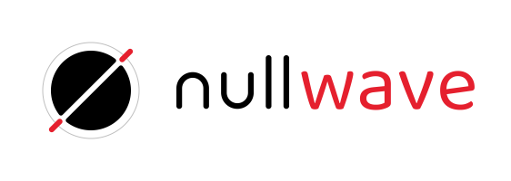

  <picture>
    <source media="(prefers-color-scheme: dark)" srcset="assets/logotype-dark.svg">
    
  </picture>

# nullwave for the FM-1

A groovebox firmware for the M-VAVE FM-1, with six equal channels. Any channel can be a synth, a drum kit, a
sampler or a MIDI output, and all six share one pool of voices, so there is no fixed drum track.

**Status: early development.** Nothing here is ready to install yet.

## Plan for 1.0

- Six channels, each with its own sequencer (patterns of 1 to 8 bars, its own length, time signature and step
  size), mix strip, sidechain and MIDI channel. Patterns chain into songs.
- Engines: ANALOG, LOFI, TRIO, WHEEL, NOISE and PHASE (Felucca-Engines), plus FM, sample and slice, drum, wavetable,
  formant voice, granular and physical models.
- Shared tape delay and reverb, drive, fold and bitcrush per channel, a master compressor and limiter.
- Scales on the keys: every key glows faintly, scale keys brighter, roots lit.
- An audio looper that records the internal mix.
- USB, TRS and Bluetooth MIDI, and a control mode for driving music apps from the FM-1.
- A web editor.

## Layout

| Path | What |
| --- | --- |
| `app/` | The firmware: UI, sequencer, projects, MIDI |
| `base/` | [fm1-base](https://github.com/charlesvestal/fm1-base) (submodule), with [felucca-bsp](https://github.com/hugelton/felucca-bsp) in `base/bsp/` |
| `engines/felucca/` | [Felucca-Engines](https://github.com/hugelton/Felucca-Engines) (submodule) |
| `tests/` | Host tests |

## Build

    git clone --recursive https://github.com/nullwave-cc/fm1
    ./build.sh --host               # the host simulator, no toolchain needed
    sh tests/run_tests.sh           # host tests
    ./build.sh --setup              # once: the pinned JieLi toolchain and SDK files
    ./build.sh                      # the FM-1 package: app/build/nullwave.fwsc
    ./build.sh --web                # the browser emulator

## Install

See [docs/INSTALL.md](docs/INSTALL.md). Back up the FM-1 first.

## Licence

MPL-2.0, see [LICENSE](LICENSE). Credits for the parts this is built on are in [CREDITS.md](CREDITS.md).

M-VAVE and FM-1 are trademarks of their owners. nullwave is not affiliated with M-VAVE.
