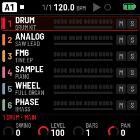
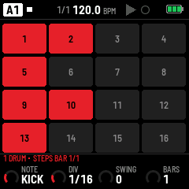
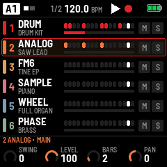
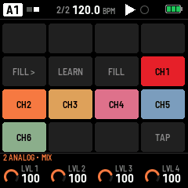
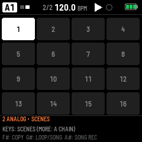
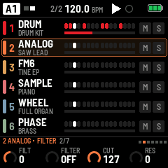

# nullwave manual

nullwave turns the FM-1 into a six-channel groovebox. Each channel plays one of thirteen instruments, synths or a drum
kit. Each channel has its own patterns. You record loops from the keys, put patterns together in scenes, switch scenes
live while you play, and chain scenes into songs. Eight songs stay on the FM-1.

This is the reference: every button, layer, page and setting in tables. For a walk through it all in plain English,
with pictures, read the [guide](../../docs/GUIDE.md).

A **tap** of a function button opens its pages. A **hold** turns the 16 white keys and KNOB 1–4
into that button's layer. **SHIFT** is OCT− or OCT+ held. Entries marked **◆** are nullwave's own.

## What's new in 0.3

- **SETTINGS**, a screen of its own for everything that belongs to the FM-1 (hold HOME, or SHIFT + GLO): SCREEN,
  LIGHTS, AUDIO, SEQ, SYSTEM, MIDI, KEYS, BLUETOOTH. GLO's pages are the song's only.
- **Keys:** the drum key map (C4 the kick), the GLO layer (D4 MIDI LEARN, E4 FILL), C4 the root in WHITE
  mode, EDIT + black keys muting drum lanes, one slice a key on SLICE, and the STD kit.
- **Recording:** REC MODE OVERDUB / REPLACE (SHIFT + REC), EDIT + REC clears the channel at once.
- **Steps:** SEQ + SELECT picks the bar the keys edit (`STEPS BAR 2/4`).
- **Scenes:** SAVE + a scene's key held 1 s stores what plays now into it; a short press launches, on release.
- **Graphs:** SHIFT + a page's button draws the page (ENV, LFO, FILTER, a scope, DELAY, SLICER, ARP, SEL, INSERT).
- **Buttons:** a tap acts once, when let go; a hold once, at its time; every button debounced. HOME lit on MAIN.
- **Sound:** FM6 much lighter on the CPU, almost no load standing by, VOICE LIMIT instead of broken audio.

## The screen

- **Top bar:** song and scene (`A1`: song A, scene 1); the selected channel's bars, the one playing lit; the bar count
  (`1/2`), or the queued scene blinking red (`>A3`); the tempo; play; record (a ring: armed; red: recording); the
  battery.
- **The six channels:** colour tab, engine and sound, the 16 sixteenths of the bar playing (lit where there are notes,
  white at the playhead), the level meter, **M**ute and **S**olo. The selected channel has a tinted box, outlined red
  while it records. A channel you cannot hear is drawn faded.
- **Footer:** channel, engine and page title (messages appear here for a moment), page dots, four knobs.
- While a layer is held, its 16 keys show as tiles. On a page with a graph, **◆** SHIFT + the page's button shows the
  graph above the footer. On SEQ's NOTES and DRUMS pages, the area above the footer shows the notes.

## The buttons

| Button | Tap | Hold (layer) | SHIFT + button | Button + key / knob |
|---|---|---|---|---|
| **FX** | FX, FILTER, SLICER, INSERT, INSERT 2, DELAY, REVERB | Punch-in layer: 27 effects on the keys while held; K1 FILT (master DJ filter), K2 DUST, K3 DUCK, K4 the channel's one-knob filter | **◆** graph (FILTER, SLICER, INSERT, DELAY) | FX + OCT−: reverb throw, FX + OCT+: echo throw (while held). FX + SELECT: punch-in fade |
| **SEL** | KEY, KEY 2 | Key layer: K1 CHORD, K2 SCALE, K3 KEYS, K4 TRANSPOSE | **◆** graph (the scale on a keyboard) | SEL + key: the song's root |
| **ENV** | ENV, ENV DEST | — | **◆** graph (the ADSR, the playing voice on it; the envelope on each destination) | — |
| **LFO** | LFO, LFO 2, LFO DEST | — | **◆** graph (one cycle, phase, fade, a moving dot) | — |
| **EDIT** | EDIT 1, EDIT 2, then the engine's own (FILTER on ANALOG; OPERATOR, OP ENV, OPERATOR 2 on FM6; LANES, LANES 2 on DRUM), VOICE, VOICE 2 | Erase layer: K1 SHIFT, K2 LENGTH (×2 / ½), K3 TRANSPOSE | **◆** graph (a scope of the channel; the engine filter's curve) | EDIT + key: erase that note (playing: where the playhead passes while held; stopped: all of it). On DRUM, EDIT + black keys 1–8 mute its lanes. EDIT + OCT−: undo, + OCT+: redo |
| **GLO** | The song's pages: GLOBAL, MASTER, TEXTURE, TEXTURE 2, DRUMS | Mix layer: D4 MIDI LEARN, E4 fill while held, C4 the next bar a fill, F4–D5 mute channels 1–6, black keys F#4–F#5 solo them, G5 tap tempo; K1–K4 levels of channels 1–4 | **◆** the SETTINGS screen | — |
| **HOME** | Back to MAIN (HOME is lit while MAIN is on screen). On MAIN: the visualiser (BARS, RINGS, SCOPE, off). In SETTINGS: the next group. Hold a layer and tap HOME: the layer stays (its button again closes it) | The SETTINGS screen (held again: out) | — | — |
| **SAVE** | The SONG page; on it, saves (tap twice). SELECT: PRESETS, USER, SONG, SCENE, CHAIN, TOOLS | Scene layer: keys 1–16 launch scenes; more keys in one hold chain them; F# copy; G# loop / song; A# song recording | — | — |
| **ARP** | ARP, ARP 2 | Roll layer: held keys repeat at ROLL; OCT− held: ghost, OCT+: hard; K1 ROLL | **◆** graph (the note order over the octaves) | — |
| **SEQ** | PATTERN, then NOTES (a synth) or DRUMS (a kit) | Step layer: keys are the 16 steps of a bar (a page of 16 steps); SELECT picks the bar (`STEPS BAR 2/4`, the top bar lights it; DRUMS follows it). K1 note, K2 DIV, K3 swing, K4 bars. Hold a step: K1 NOTE, K2 VEL, K3 RATCH (ratchet ×1–×4), K4 NUDGE; ALGORITHM picks a parameter to lock, PRESETS sets it | — | SEQ + SELECT or OCT−/OCT+: the bar. Held step + OCT−: clear its extras; + OCT+: fill condition (ALWAYS, FILL ONLY, NO FILL). On a kit, SEQ + black key: the lane to place |
| **PLAY** | Play / stop (song mode: the chain) | — | — | — |
| **REC** | Playing: record on the selected channel (tap again to stop). Stopped: arm (REC page) | 2 s: clear the channel's pattern (recording, armed or not) | **◆** REC MODE: OVERDUB ↔ REPLACE | EDIT + REC: clear the channel at once |
| **OCT−** / **OCT+** | Octave down / up on release, if nothing else was pressed. Both: octave 0 | SHIFT | — | — |

A tap (under half a second, nothing else touched) acts once, when you let go. A hold acts once, when its time comes
(a layer after 0.35 s, or as soon as you use a key or knob; SETTINGS after 0.7 s; REC's clear after 2 s), and its
release does nothing more. PLAY acts as you press it. Every button is debounced: a contact that chatters counts once.
LOAD, SAVE, NEW, CLRSQ, INIT and user preset ERASE ask once (`AGAIN: …`); a second turn within 1.5 s does it.

## SHIFT combinations

| Combination | Does |
|---|---|
| SHIFT + GLO | the SETTINGS screen, at SCREEN (as HOME held) |
| SHIFT + ENV | the ENV or ENV DEST graph on or off |
| SHIFT + LFO | the LFO graph on or off |
| SHIFT + FX | the FILTER, SLICER, INSERT or DELAY graph on or off (from FX itself: on to FILTER) |
| SHIFT + EDIT | the scope (EDIT 1, EDIT 2) or the engine filter's graph on or off |
| SHIFT + ARP | the ARP graph on or off |
| SHIFT + SEL | the scale graph on or off |
| SHIFT + REC | REC MODE: OVERDUB ↔ REPLACE |
| OCT− + OCT+ | octave 0 |

A graph stays on or off for that kind of page until you change it. SETTINGS → SCREEN → GRAPHS sets what every page
starts with (OFF by default) and clears the per-page choices.

## The knobs

- **SELECT:** on MAIN and in layers, the tempo. On a page, the pages of its button (stopping at the ends). In SETTINGS,
  its pages. With FX held, the punch-in fade.
- **ALGORITHM:** the channel, 1–6. With a SEQ step held: the parameter to lock.
- **PRESETS:** the channel's sound: favourites first, then every engine's sounds, then the user presets. With a SEQ
  step held: the lock's value.
- **KNOB 1–4:** the four values in the footer; in SETTINGS, its four rows.

## Pages

**ENV:** ENV (ATK, DEC, SUS, REL); ENV DEST (FLT, PIT, SHP: how far the envelope moves the engine's cutoff, the pitch
and the shape, −64..63).

**LFO:** LFO (RATE, WAVE SIN TRI SAW SQR S&H, PHS, FADE); LFO 2 (SYNC OFF, 4BAR … 1/32; TRIG NOTE / FREE; POL BI /
UNI); LFO DEST (PIT, FLT, SHP, AMP, −64..63).

**FX:**

| Page | KNOB 1 | KNOB 2 | KNOB 3 | KNOB 4 |
|---|---|---|---|---|
| FX | DST (drive) | CHO (chorus send) | DLY (delay send) | REV (reverb send) |
| FILTER | FILT (one knob: left low-pass, right high-pass) | FILTER (OFF, LP, HP, BP) | CUT | RES |
| SLICER | SLCR (OFF, GATE, STUT) | PAT (1–16) | RATE (1/8 … 32T) | DEPTH |
| INSERT | INSRT (SOFT, HARD, FOLD, FUZZ, CRUSH, PHASR, FLANG, CHOR) | A | B | C |
| INSERT 2 | MIX | | | |
| DELAY | TIME (1/32 … 1/2, dotted) | FDBK | TONE | LEVEL |
| REVERB | SIZE | DAMP | CRT (chorus rate) | CDP (chorus depth) |

On the drives A is the drive, B the tone, C the level; on CRUSH, A the bits, B the rate, C a low-pass; on the
modulations, A the rate, B the depth, C the feedback.

**SEL:** KEY (ROOT, SCALE, KEYS OFF / SNAP / WHITE, CHORD OFF / TRIAD / 7TH / 9TH / SUS4 / POWER); KEY 2 (TRANSP ±24,
STRUM ±60 ms, VLEAD).

**EDIT:** EDIT 1 and EDIT 2 are the engine's eight (below). ANALOG adds FILTER (TYPE LP / BP / HP, CUT, RES, KTR). FM6
adds OPERATOR (OP, RATIO, FINE, LEVEL), OP ENV (OP, STAGE, RATE, LEVEL), OPERATOR 2 (OP, MODE, DTUN, VEL). DRUM adds
LANES and LANES 2 (each lane's level). Then VOICE (VCE POLY / MONO / LEG / UNI, GLD, GLMOD RATE / TIME, PRIO LAST / LOW
/ HIGH) and VOICE 2 (ALLOC ROT / REUSE, DTUNE, PAN, MUTE).

**ARP:** ARP (MODE: OFF, UP, DN, UPDN, RND, ORD, REPEAT, DNUP, UP+8, CONV, DIVG, PINKY, THUMB, WALK, CHORD; RATE 1/4 …
1/32; OCT 1–4; GATE); ARP 2 (SWG, PROB, HOLD, ORD NOTE / PLAY). HOLD with MODE OFF latches the keys.

**SEQ:** PATTERN (BARS 1–8; DIV 1/32, 1/16T, 1/16, 1/8T, 1/8, 1/4, 1/2, 1 BAR, 2 BAR; SWING; PATTERN 1–16).
NOTES on a synth (NOTE# the note picked, PITCH, MOVE by a step, LENGTH). DRUMS on a kit (LANE, STEP, HIT, VEL).

**GLO:**

| Page | KNOB 1 | KNOB 2 | KNOB 3 | KNOB 4 |
|---|---|---|---|---|
| GLOBAL | BPM | SWING (the song's) | CLICK OFF / REC / ON | TUNE ±50 cents |
| MASTER | DUST | DUCK (a kick pumps the rest) | FILT (DJ filter) | ROLL (1/8 … 1/64) |
| DRUMS | LVL | REV | DLY (the selected kit, or the first) | |
| TEXTURE | SRC (OFF, VINYL, TAPE, RAIN, WIND, RADIO, ROOM) | LEVEL | TONE | MOVE |
| TEXTURE 2 | RATE (1–16 bars) | WHEN PLAY / ALWAYS | DUCK | |

**SAVE:** PRESETS (SOUND, ENGINE, FAV); USER (SLOT 1–32, LOAD, ERASE, SAVE); SONG (SONG A–H, LOAD, SAVE, NEW); SCENE
(SCENE, CHANNEL, PATTERN, SOUND); CHAIN (STEP, SCENE, BARS, REPEAT); TOOLS (CLRSQ, INIT, NEW).

**REC** (armed): MODE FREE / TEMPO, BARS 1 / 2 / 4 / 8, START NOTE / COUNT, QUANT.

## SETTINGS

Everything that belongs to the FM-1 itself, not to a song or a sound, is on its own full screen: hold HOME (or press
SHIFT + GLO). A title bar names the group, its dots show the group's pages; below, up to four rows, KNOB 1–4 one each.
SELECT turns the pages, HOME tapped goes to the next group, HOME held again leaves. Each setting is here once and
nowhere else.

| Group | KNOB 1 | KNOB 2 | KNOB 3 | KNOB 4 |
|---|---|---|---|---|
| SCREEN | THEME DARK / LIGHT | KNOB ACCEL | GRAPHS OFF / ON | |
| LIGHTS | BUTTON LIGHTS | SCALE ON KEYS | | |
| AUDIO | SPEAKER LOWCUT | USB AUDIO MASTER / FULL | FILTER RESO | |
| SEQ | STEP ADVANCE | DRUM PREVIEW | SCENE LAUNCH (BAR, LOOP, NOW) | REC MODE (OVERDUB / REPLACE) |
| SYSTEM | VERSION | AUTOSAVE | CPU | |
| MIDI 1/4 | CHANNEL 1 | CHANNEL 2 | CHANNEL 3 | CHANNEL 4 |
| MIDI 2/4 | CHANNEL 5 | CHANNEL 6 | MIDI IN (NOTES, CLOCK, CH n) | OTHER CH (SEL / OFF) |
| MIDI 3/4 | MIDI OUT (KEYS / SEQ) | BEND RANGE (1–12) | DRUM MAP (GM / 1-16) | FX CHANNEL |
| MIDI 4/4 | REMOTE | CLOCK OUT | SYNC (INT, USB, TRS, BLE) | |
| KEYS | VELOCITY (−5..+5) | KEY LEARN | FIXED VEL | PRESSURE (OFF, FILTER, VOLUME, BOTH) |
| BLUETOOTH | BLUETOOTH | DEVICE | CONNECT | |

Settings save themselves a moment after you change them.

## Instruments

| Engine | EDIT 1 | EDIT 2 | Sounds |
|---|---|---|---|
| ANALOG | WAVE, DTN, MIX, NOIS | CUT, RES, DRV, KTR | SAW LEAD, SOFT PAD, SQR BASS, PWM STR, ACID, SINE KEY, RAVE, SUB BASS, PLUCK, BRASS, WIND, STRINGS |
| FM6 | ALG, FB, MLVL, MRAT | MEG, VMOD, DTUN, SLOT | TINE EP, BELL, FM BASS, BRASS, PAD, MARIMBA, ORGAN, PLUCK |
| PHASE | WAVE, WAVE2, DCW, ENV | DTN, LINE, SUB, FOLD | BRASS, ORGAN, STRING, RESO, BELL, WIRE |
| LOFI | CHIP, WAVE, DUTY, CRSH | SWP, VIB, ARP, TONE | PULSE LD, WAVE BASS, ARP 8BIT, WAVE LEAD, STEP LEAD |
| SAMPLE | SET, TUNE, BITS, LOOP | CUT, DRV | PIANO, FLUTE, SAX |
| VOICE | VOWL, VOWL2, TALK, SHIFT | BUZZ, BRTH, Q, RAND | CHOIR AAH, VOX LEAD, WOW BASS, WHISPER |
| TRIO | WAVE, INT2, INT3, DTN | MODE, CUT, RES, PW | FAT BASS, ARP LEAD, SYNC LEAD, RING BELL, CHIP CHOIR |
| WHEEL | REG, SUB, BODY, TOP | PERC, CLICK, DRV, ROTR | FULL ORGAN, JAZZ PERC, GOSPEL, SOFT FLUTE, ROCK DRIVE |
| GRAIN | SRC, POS, SIZE, DENS | PTCH, SPRD, RAND, TONE | CLOUD PAD, GLITCH, FROZEN, SHIMMER |
| PHYS | MODEL, STRC, BRIT, DAMP | POS, ACC, BOW, EXC | BELL TREE, MARIMBA, PLUCK, BOWED METAL, KALIMBA, HAND DRUM, TOMS, DRONE STRING, HARP |
| NOISE | MODE, COLR, FREQ, RES | TRK, DENS, DRFT, CRSH | WIND, RAIN, ARCADE, METAL |
| SLICE | SRC, SLCS, TUNE, LEN | RVRS, TONE, DRV, CRSH | CHOP, STUTTER |
| DRUM | KIT, TUNE, DECAY, TONE | DRIVE, CRUSH, ACCENT, LEVEL | DRUM KIT (STD), DEEP KIT, TIGHT KIT, PERC KIT |

A new song starts with DRUM, ANALOG, FM6, SAMPLE, WHEEL and PHASE on channels 1–6.

**Voices.** Each channel plays up to 6 notes at once; FM6 and VOICE up to 4, SAMPLE, GRAIN and PHYS up to 3 (MONO,
LEG: 1). A note past that takes the oldest note's voice, so the newest always plays. If the sound engine ever comes
within 5 % of running out of time, the oldest note fades out (over a few ms) and the screen says `VOICE LIMIT`,
instead of the audio breaking up; `CPU OVERLOAD` means a block did run late. SETTINGS → SYSTEM → CPU shows the load
(a few % standing by: silent channels, effects and the master cost nothing then).

**DRUM** has eight lanes: KICK (MIDI 36), SNARE (38), CLAP (39), HATCL (42), HATOP (46), TOM (45), RIM (37), BELL (56).
The keys play General MIDI drum notes, whatever the octave:

| Key | C4 | C#4 | D4 | D#4 | E4 | F#4 | G#4 | A#4 | F4 G4 A4 B4 C5 D5 | C#5 D#5 E5… |
|---|---|---|---|---|---|---|---|---|---|---|
| Plays | KICK | RIM | SNARE | CLAP | SNARE | HATCL | HATCL (pedal) | HATOP | TOM, low to high | BELL (cymbals) |

F3–B3 play the same as F4–B4. The closed hat cuts the open one. KIT picks STD (the standard kit), 80, 10, 66,
55, 77, DEEP, TIGHT or PERC; a MIDI program change 0–8 picks the kit too. Hold EDIT and press black keys 1–8 to mute
the lanes.

**SLICE** puts one slice on each key from F3, round the slices. **FM6** SLOT picks F1–F8 (the factory patches), OWN (the channel's own,
edited on the operator pages or sent as a DX7 voice SysEx) or B1–B32 (a DX7 32-voice bank sent by SysEx, kept).

## Keys, scales and chords

16 scales: CHROM, MAJOR, MINOR, DORIAN, PHRYG, LYDIAN, MIXO, LOCR, HARM, MELOD, PENT, MPENT, BLUES, WHOLE, HIRAJ, DIM.
KEYS: OFF (every key its own note), SNAP (off the scale: the scale note below), WHITE (C4 plays the root, the white keys walk the scale up and down from it).

With a CHORD set, the white keys walk the scale from C4 and play its chord on each degree; the black keys change the
chord while held (**CHORD+**): F# major ↔ minor, G# add the 7th, A# sus4, C# add the 9th, D# an inversion. STRUM plays a
chord's notes apart (+ low to high, − high to low). VLEAD keeps each chord near the last.

## Punch-in effects (FX held)

| White key | Effect | Black key | Effect |
|---|---|---|---|
| F3 | LOOP 1/4 | F#3 | KILL LOW |
| G3 | LOOP 1/8 | G#3 | KILL MID |
| A3 | LOOP 1/16 | A#3 | KILL HIGH |
| B3 | LOOP 1/32 | C#4 | REWIND |
| C4 | STUTTER | D#4 | OCT UP |
| D4 | REVERSE | F#4 | FLANGER |
| E4 | TAPE STOP | G#4 | AUTO-PAN |
| F4 | HALF | A#4 | FREEZE |
| G4 | LP SWEEP | C#5 | LOOP 8T |
| A4 | HP SWEEP | D#5 | MONO |
| B4 | PHONE | F#5 | FADE OUT |
| C5 | CRUSH |  |  |
| D5 | ALIAS |  |  |
| E5 | GATE |  |  |
| F5 | ECHO |  |  |
| G5 | WOBBLE |  |  |

They last while held, and several stack.

## Sequencer

- **REC MODE:** OVERDUB (each pass adds to what is there) or REPLACE (as the playhead passes while recording, what
  was there goes: a new pass overrides the take). SHIFT + REC flips it at once, even while recording; SETTINGS → SEQ
  → REC MODE is the same setting. REPLACE shows an R in the top bar's record dot, and the armed REC page says which.
- **Overdub:** REC while playing; each pass adds. QUANT on snaps to the steps.
- **Armed:** REC while stopped (the REC page). FREE: the first note starts a free take, closed with REC on the loop's
  one; its length picks the tempo. COUNT: PLAY counts in a bar.
- **Steps:** hold SEQ. **Locks:** hold a step, ALGORITHM picks the parameter, PRESETS sets it.
- **Fills:** GLO + E4 (while held) or C4 (the next bar). Steps marked FILL ONLY play only then, NO FILL never then.
- **NOTES, DRUMS:** SEQ's second page, see Pages.
- **Undo / redo:** EDIT + OCT− / OCT+. **Clear:** EDIT + REC (at once), REC held 2 s, or SAVE → TOOLS → CLRSQ; each undone with EDIT + OCT−.

## Scenes and songs

16 scenes a song, one a white key; a scene holds each channel's pattern, the mutes, solos and levels, and with SOUND
on the sounds. SAVE + key launches (stopped: at once; playing: at LAUNCH: BAR, LOOP or NOW), when the key is let go. SAVE + a key
held 1 s stores what plays now into that scene (`SCENE 3 STORED`). More keys in one hold make
a quick chain. SAVE + F# then a key copies the scene. SAVE + G#: loop / song mode. SAVE + A#: song recording (each
launch a section). The CHAIN page edits the song. Eight songs (A–H) in flash, 32 KB each; AUTOSAVE saves after 3 s
stopped and idle.

## MIDI

Channels 1–6 on MIDI channels 1–6 (SETTINGS → MIDI; two never share). In: notes, pitch bend (BEND), poly aftertouch,
sustain (CC 64), program change (the engine's preset; on DRUM, 0–8 the kit), CC 1 LFO pitch depth, 5 GLIDE, 7 and 11 level, 10 PAN, 71 RES,
72 REL, 73 ATK, 74 CUT, 75 DEC, 91 REV, 93 CHO, 94 DLY, 121 reset. **MIDI LEARN:** GLO + D4, turn a knob, send a CC (8
kept). FX CH: notes 36–62 on that channel hold the punch-ins. REMOTE: CC 102–115 press the buttons. Clock: SYNC
follows USB, TRS or BLE; a lost clock (0.5 s) keeps its tempo. CLOCK sends clock over USB, also while stopped.
Bluetooth MIDI: SETTINGS → BLUETOOTH. The MIDI settings are in SETTINGS → MIDI.

## Not yet

User samples and the web editor; more visualiser styles and kits; ties and slides on steps.
