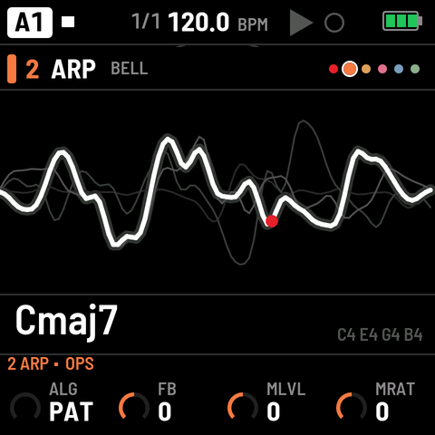
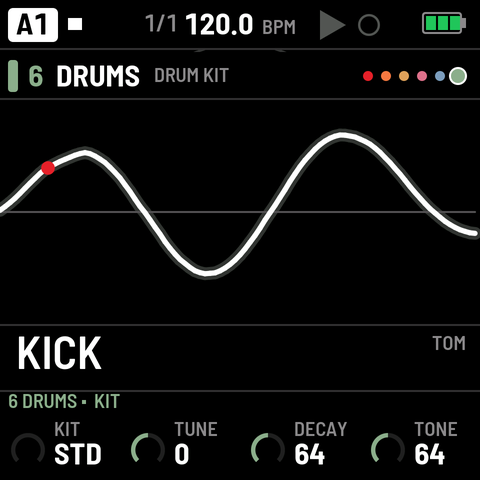
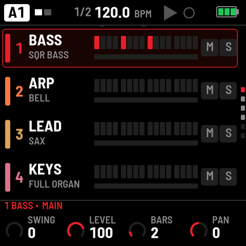
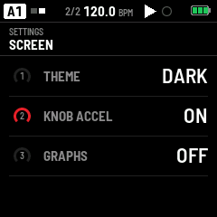
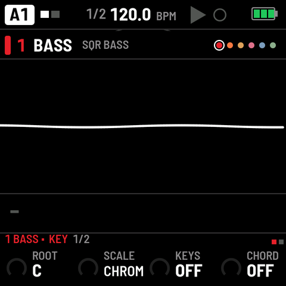
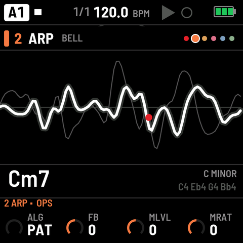

# nullwave manual

nullwave turns the FM-1 into a six-channel groovebox. Each channel plays one of fourteen instruments, synths or a drum
kit. Each channel has its own patterns. You record loops from the keys, put patterns together in scenes, switch scenes
live while you play, and chain scenes into songs. Eight songs stay on the FM-1.

This is the reference: every button, layer, page and setting in tables. For a walk through it all in plain English,
with pictures, see the [quick start](https://nullwave.cc/fm1/quick-start/).

A **tap** of a function button opens its pages. A **hold** turns the 16 white keys and KNOB 1–4
into that button's layer. **SHIFT** is OCT− or OCT+ held. Entries marked **◆** are nullwave's own.


## Installing, and going back to stock

nullwave is early software, so back up first. Make a full flash backup of the FM-1 with
[M-Flasher](https://github.com/jvitkauskas/m-flasher) before the first install, and keep the file. It puts the FM-1
back exactly as it was, whatever happens.

**The easy way.** Open the nullwave installer page in Chrome or Edge, connect the FM-1 with a USB cable and switch it
on. The page finds it, shows what it will write and asks before writing. The ring around the logo at the top fills as
the install goes. On the FM-1, nullwave says INSTALLING for a moment; then a short list of steps in white, and the
FM-1's own updater: a cream screen with UPDATING, DO NOT UNPLUG and a bar (or it stays dark). That screen belongs to
the FM-1's updater, not to nullwave, and it means all is well. When it is done the FM-1 restarts into nullwave, the
logo saying INSTALLED and the version. Later versions install the same way, over the top; your songs and settings stay.

**From a terminal.** With Python installed:

```
python3 -m pip install --user mido python-rtmidi
python3 base/tools/fm1_install.py nullwave.fwsc
```

**Going back.**

- To M-VAVE's own firmware: the "Back to the stock firmware" button on the installer page, or M-VAVE's updater
  (M-UPGRADE) with their firmware file.
- To exactly what you had before: restore the M-Flasher backup.
- If nullwave starts but the computer cannot see it over USB: hold REC while switching on. The FM-1 starts in its
  update mode and the installer can write it again. After two failed starts in a row, nullwave also opens a safe mode
  of its own where USB still works.
- To start over as just installed: FACTORY RESET. On the FM-1, SETTINGS → SYSTEM 2, turn KNOB 1 (RESET), then hold
  PLAY for 3 seconds (let go sooner and nothing happens); or "Reset to factory" on the installer page, which offers a
  backup of the songs, user sounds and settings first and asks you to type RESET. It erases every song (with its
  scenes and channel names), the user sounds, the FM6 bank and every setting, the logo's ring filling as it goes,
  then restarts as a fresh install does (INSTALLED on the logo). nullwave itself, the FM-1's calibration, its
  Bluetooth pairings and the FM-1's updater stay.
- If a setting leaves the FM-1 silent or odd: hold HOME while switching on. Every setting goes back to how it was
  when installed (SETTINGS, the octave, the channel the keys play); the songs, your sounds and the names stay, and the
  song that was open opens. The screen says `SETTINGS RESET` `SONGS KEPT`.
- If nothing starts at all: restore the backup with M-Flasher. If you installed the recovery bootloader the installer
  offers, hold PLAY while switching on to reach its menu instead.

[docs/INSTALL.md](https://github.com/nullwave-cc/fm1/blob/main/docs/INSTALL.md) has the same steps with more detail.

## The screen

- **Top bar:** song and scene (`A1`: song A, scene 1); the selected channel's bars, the one playing lit; the bar count
  (`1/2`), or the queued scene blinking red (`>A3`); the tempo; play; record (a ring: armed; red: recording); the
  battery (a plug in it on USB power).
- **◆ PLAY** (MAIN's view at power-on): a line with the selected channel's colour, number, name and sound, and six
  dots, one a channel (the selected ringed, each swelling as its channel plays); then the sound itself: the channel's
  own output as a smooth line with a soft glow, the last moments fading behind it, still on the note's cycle and as
  tall as it is loud.

  Red marks the newest note, where its pitch falls on the line. The modulation shows too: the LFO moves the wave up
  and down in its own shape and rate, and so do the pitch's moves. Under it, the chord (`Cm7`), the notes sounding by name
  and the key (`C MINOR`), or on a kit the drum hit; in red instead, why the channel is silent, if it is
  (Troubleshooting). KNOB 1–4: the engine's EDIT 1.
- **◆ LOOP:** four channels at a time (the selected one among them, the list sliding; dots on the right show which
  four): colour tab, the channel's name (or, with none, its engine) over its sound, the 16 sixteenths of the bar
  playing (lit where there are notes, white at the playhead), the level meter, **M**ute and **S**olo. The selected
  channel has a tinted box, outlined red while it records. A channel you cannot hear is drawn faded. KNOB 1–4: SWING,
  LEVEL, BARS, PAN.
- **◆ SHIFT + HOME** switches PLAY and LOOP. PLAY (the transport) and REC show LOOP while they last and go back to PLAY
  after (AUTO LOOP); SHIFT + HOME meanwhile keeps the view you pick till it stops. HOME VIEW sets the view at power-on.





- **Footer:** channel and its name (or engine), the page title (messages appear here for a moment), page dots, four knobs.
- While a layer is held, its 16 keys show as tiles. On a page with a graph, **◆** SHIFT + the page's button shows the
  graph above the footer. On SEQ's NOTES and DRUMS pages, the area above the footer shows the notes.

## The buttons

| Button | Tap | Hold (layer) | SHIFT + button | Button + key / knob |
|---|---|---|---|---|
| **FX** | FX, FILTER, SLICER, INSERT, INSERT 2, DELAY, REVERB | Punch-in layer: 27 effects on the keys while held; K1 FILT (master DJ filter), K2 DUST, K3 DUCK, K4 the channel's one-knob filter | **◆** graph (FILTER, SLICER, INSERT, DELAY) | FX + OCT−: reverb throw, FX + OCT+: echo throw (while held). FX + SELECT: punch-in fade |
| **SEL** | KEY, KEY 2 | Key layer: K1 CHORD, K2 SCALE, K3 KEYS, K4 TRANSPOSE | **◆** graph (the scale on a keyboard) | SEL + key: the song's root |
| **ENV** | ENV, ENV DEST | — | **◆** graph (the ADSR, the playing voice on it; the envelope on each destination) | — |
| **LFO** | LFO, LFO 2, LFO DEST | — | **◆** graph (one cycle, phase, fade, a moving dot) | — |
| **EDIT** | EDIT 1, EDIT 2, then the engine's own (FILTER on ANALOG; OPERATOR, OP ENV, OPERATOR 2 on FM6; LANES, LANES 2 on DRUM), VOICE, VOICE 2, PITCH | Erase layer: K1 SHIFT, K2 LENGTH (×2 / ½), K3 TRANSPOSE | **◆** graph (a scope of the channel; the engine filter's curve) | EDIT + key: erase that note (playing: where the playhead passes while held; stopped: all of it). EDIT + the black keys by their printed legends: OP1–OP6 (FM6: that operator's page; held 0.5 s: the operator muted or back; other engines: OP1, OP2 open EDIT 1, EDIT 2), PIT (the PITCH page), GLO (glide on / off), MONO, POLY (the voice mode); on DRUM, black keys 1–8 mute its lanes instead. EDIT + OCT−: undo, + OCT+: redo |
| **GLO** | The song's pages: GLOBAL, MASTER, TEXTURE, TEXTURE 2, DRUMS | Mix layer: D4 MIDI LEARN, E4 fill while held, C4 the next bar a fill, F4–D5 mute channels 1–6, black keys F#4–F#5 solo them, G5 tap tempo; K1–K4 levels of channels 1–4 | **◆** the SETTINGS screen | — |
| **HOME** | Back to MAIN (HOME is lit while MAIN is on screen). In SETTINGS: the next group. Hold a layer and tap HOME: the layer stays (its button again closes it) | The SETTINGS screen (held again: out) | **◆** MAIN as PLAY ↔ LOOP | — |
| **SAVE** | The SONG page; on it, saves (tap twice). SELECT: PRESETS, USER, SONG, SCENE, CHAIN, TOOLS | Scene layer: keys 1–16 launch scenes; more keys in one hold chain them; F# copy; G# loop / song; A# song recording | **◆** NAME: the selected channel's name | — |
| **ARP** | ARP, ARP 2 | Roll layer: held keys repeat at ROLL; OCT− held: ghost, OCT+: hard; K1 ROLL | **◆** graph (the note order over the octaves) | — |
| **SEQ** | PATTERN, then NOTES (a synth) or DRUMS (a kit) | Step layer: keys are the 16 steps of a bar (a page of 16 steps); SELECT picks the bar (`STEPS BAR 2/4`, the top bar lights it; DRUMS follows it). K1 note, K2 DIV, K3 swing, K4 bars. Hold a step: K1 NOTE, K2 VEL, K3 RATCH (ratchet ×1–×4), K4 NUDGE; ALGORITHM picks a parameter to lock, PRESETS sets it | — | SEQ + SELECT or OCT−/OCT+: the bar. Held step + OCT−: clear its extras; + OCT+: fill condition (ALWAYS, FILL ONLY, NO FILL). On a kit, SEQ + black key: the lane to place |
| **PLAY** | Play / stop (song mode: the chain) | — | **◆** HOLD: the keys latch their notes (tap one again: it ends); again: off | — |
| **REC** | Playing: record on the selected channel (tap again to stop). Stopped: arm (REC page) | 2 s: clear the channel's pattern (recording, armed or not) | **◆** REC MODE: OVERDUB ↔ REPLACE | EDIT + REC: clear the channel at once |
| **OCT−** / **OCT+** | Octave down / up on release, if nothing else was pressed. Both: octave 0 | SHIFT | — | — |

A tap (under half a second, nothing else touched) acts once, when you let go. A hold acts once, when its time comes
(a layer after 0.35 s, or as soon as you use a key or knob; SETTINGS after 0.7 s; REC's clear after 2 s), and its
release does nothing more. PLAY acts as you press it. Every button is debounced: a contact that chatters counts once.
LOAD, SAVE, NEW, CLRSQ, INIT and user preset ERASE ask once (`AGAIN: …`); a second turn within 1.5 s does it.

## SHIFT combinations

| Combination | Does |
|---|---|
| SHIFT + GLO | the SETTINGS screen, at SCREEN (as HOME held) |
| SHIFT + ENV | the ENV or ENV DEST graph on or off |
| SHIFT + LFO | the LFO graph on or off |
| SHIFT + FX | the FILTER, SLICER, INSERT or DELAY graph on or off (from FX itself: on to FILTER) |
| SHIFT + EDIT | the scope (EDIT 1, EDIT 2) or the engine filter's graph on or off |
| SHIFT + ARP | the ARP graph on or off |
| SHIFT + SEL | the scale graph on or off |
| SHIFT + REC | REC MODE: OVERDUB ↔ REPLACE |
| SHIFT + HOME | **◆** MAIN as PLAY ↔ LOOP |
| SHIFT + PLAY | **◆** HOLD on the channel: each key latches its note, tapped again it ends; again: HOLD off, all end |
| SHIFT + SAVE | **◆** NAME: the selected channel's name (SAVE again keeps it, HOME leaves it as it was) |
| OCT− + OCT+ | octave 0 |

A graph stays on or off for that kind of page until you change it. SETTINGS → SCREEN → GRAPHS sets what every page
starts with (OFF by default) and clears the per-page choices.

## The knobs

- **SELECT:** on MAIN and in layers, the tempo. On a page, the pages of its button (stopping at the ends). In SETTINGS,
  its pages. With FX held, the punch-in fade.
- **ALGORITHM:** the channel, 1–6. With a SEQ step held: the parameter to lock.
- **PRESETS:** the channel's sound: favourites first, then every engine's sounds, then the user presets. With a SEQ
  step held: the lock's value.
- **KNOB 1–4:** the four values in the footer; in SETTINGS, its four rows.

## Pages

**ENV:** ENV (ATK, DEC, SUS, REL); ENV DEST (FLT, PIT, SHP: how far the envelope moves the engine's cutoff, the pitch
and the shape, −64..63); **◆** ENV 2 (ATK, DEC, SUS, REL: a second envelope of its own, for the mod slots: MOD 1 is
ready as a filter envelope, ENV 2 → CUT, at AMT 0).

**LFO:** LFO (RATE, WAVE SIN TRI SAW SQR S&H RND (a smooth random), PHS, FADE); LFO 2 (SYNC OFF, 4BAR … 1/32; TRIG
NOTE / FREE; POL BI / UNI); LFO DEST (PIT, FLT, SHP, AMP, −64..63); **◆** MOD 1, MOD 2, MOD 3, MOD 4, the mod slots: SRC (OFF, ENV
the volume's envelope, ENV2, LFO, VEL, PRS the key's pressure, RND a value each note), DEST (OFF, CUT the engine's
cutoff, PIT, SHP the engine's shape: PWM, the sync sweep, SUPER's morph, AMP, PAN, LFO the LFO's depth) and AMT
(−64..63). Each slot adds its source times its amount to its target, on top of ENV DEST and LFO DEST. The slots and ENV
2 are the channel's, kept with the song and with a user preset (a scene's own sounds use the song's).

**FX:**

| Page | KNOB 1 | KNOB 2 | KNOB 3 | KNOB 4 |
|---|---|---|---|---|
| FX | DST (drive) | CHO (chorus send) | DLY (delay send) | REV (reverb send) |
| FILTER | FILT (one knob: left low-pass, right high-pass) | FILTER (OFF, LP, HP, BP) | CUT | RES |
| SLICER | SLCR (OFF, GATE, STUT) | PAT (1–16) | RATE (1/8 … 32T) | DEPTH |
| INSERT | INSRT (SOFT, HARD, FOLD, FUZZ, CRUSH, PHASR, FLANG, CHOR) | A | B | C |
| INSERT 2 | MIX | | | |
| DELAY | TIME (1/32 … 1/2, dotted) | FDBK | TONE | LEVEL |
| REVERB | SIZE | DAMP | CRT (chorus rate) | CDP (chorus depth) |

On the drives A is the drive, B the tone, C the level; on CRUSH, A the bits, B the rate, C a low-pass; on the
modulations, A the rate, B the depth, C the feedback.

**SEL:** KEY (ROOT, SCALE, KEYS OFF / SNAP / WHITE, CHORD OFF / TRIAD / 7TH / 9TH / SUS4 / POWER); KEY 2 (TRANSP ±24,
STRUM ±60 ms, VLEAD).

**EDIT:** EDIT 1 and EDIT 2 are the engine's eight (below). ANALOG adds FILTER (TYPE LP / BP / HP, CUT, RES, KTR). FM6
adds OPERATOR (OP, RATIO, FINE, LEVEL), OP ENV (OP, STAGE, RATE, LEVEL), OPERATOR 2 (OP, MODE, DTUN, VEL). DRUM adds
LANES and LANES 2 (each lane's level). Then VOICE (VCE POLY / MONO / LEG / UNI, GLD, GLMOD RATE / TIME, PRIO LAST / LOW
/ HIGH), VOICE 2 (ALLOC ROT / REUSE, DTUNE, PAN, MUTE) and PITCH (ENV: the envelope on the pitch, VIB: the LFO on
it, TRANSP, GLD).

**ARP:** ARP (MODE: OFF, UP, DN, UPDN, RND, ORD, REPEAT, DNUP, UP+8, CONV, DIVG, PINKY, THUMB, WALK, CHORD; RATE 1/4 …
1/32; OCT 1–4; GATE); ARP 2 (SWG, PROB, HOLD, ORD NOTE / PLAY). HOLD with MODE OFF latches the keys: each key's
note stays on, tapped again it ends, HOLD off ends them all (SHIFT + PLAY does the same).

**SEQ:** PATTERN (BARS 1–8; DIV 1/32, 1/16T, 1/16, 1/8T, 1/8, 1/4, 1/2, 1 BAR, 2 BAR; SWING; PATTERN 1–16).
NOTES on a synth (NOTE# the note picked, PITCH, MOVE by a step, LENGTH). DRUMS on a kit (LANE, STEP, HIT, VEL).

**GLO:**

| Page | KNOB 1 | KNOB 2 | KNOB 3 | KNOB 4 |
|---|---|---|---|---|
| GLOBAL | BPM | SWING (the song's) | CLICK OFF / REC / ON | TUNE ±50 cents |
| MASTER | DUST | DUCK (a kick pumps the rest) | FILT (DJ filter) | ROLL (1/8 … 1/64) |
| DRUMS | LVL | REV | DLY (the selected kit, or the first) | |
| TEXTURE | SRC (OFF, VINYL, TAPE, RAIN, WIND, RADIO, ROOM) | LEVEL | TONE | MOVE |
| TEXTURE 2 | RATE (1–16 bars) | WHEN PLAY / ALWAYS | DUCK | |

**SAVE:** PRESETS (SOUND, ENGINE, FAV); USER (SLOT 1–32, LOAD, ERASE, SAVE); SONG (SONG A–H, LOAD, SAVE, NEW); SCENE
(SCENE, CHANNEL, PATTERN, SOUND); **◆** CHAIN (STEP, SCENE, BARS, REPEAT; the keys type the song's order, see Scenes and
songs); TOOLS (CLRSQ, INIT, NEW).

**REC** (armed): MODE FREE / TEMPO, BARS 1 / 2 / 4 / 8, START NOTE / COUNT, QUANT.

**◆ NAME** (SHIFT + SAVE): the selected channel's name, up to 8 characters: A–Z, 0–9, space and `- . / + # & !`.

| KNOB 1 | KNOB 2 | KNOB 3 | KNOB 4 |
|---|---|---|---|
| CURSOR (1–8) | CHAR (the character at the cursor) | NAME (a ready name: DRUMS, BASS, KEYS, LEAD, PAD, CHORD, ARP, FX, VOX, GTR) | CLEAR |

SAVE again keeps it (all spaces: no name, and the screen names the engine again); HOME, or another button's pages,
leaves it as it was. SELECT, ALGORITHM and PRESETS wait while it is open. The names are the song's: saved with it,
loaded with it. The name shows on the main screen's rows (the sound under it), in the footer, on the mix layer's
tiles and to a screen reader.

## SETTINGS

Everything that belongs to the FM-1 itself, not to a song or a sound, is on its own full screen: hold HOME (or press
SHIFT + GLO). A title bar names the group, its dots show the group's pages; below, up to four rows, KNOB 1–4 one each.
SELECT turns the pages, HOME tapped goes to the next group, HOME held again leaves. Each setting is here once and
nowhere else.

| Group | KNOB 1 | KNOB 2 | KNOB 3 | KNOB 4 |
|---|---|---|---|---|
| SCREEN | THEME DARK / LIGHT | KNOB ACCEL | GRAPHS OFF / ON | |
| SCREEN 2 | HOME VIEW PLAY / LOOP | AUTO LOOP ON / OFF (playing or recording: LOOP) | | |
| LIGHTS | BUTTON LIGHTS OFF / LOW / HIGH (the unlit buttons' and every key's glow, in every mode) | SCALE ON KEYS | | |
| AUDIO | SPEAKER LOWCUT | USB AUDIO MASTER / FULL | FILTER RESO | |
| SEQ | STEP ADVANCE | DRUM PREVIEW | SCENE LAUNCH (BAR, LOOP, NOW) | REC MODE (OVERDUB / REPLACE) |
| SYSTEM | VERSION | AUTOSAVE | CPU | BATTERY (%, USB or CHARGING) |
| SYSTEM 2 | FACTORY RESET (turn it, then hold PLAY 3 s) | EDITOR (turn it: the editor's page, below) | | |
| MIDI 1/4 | CHANNEL 1 | CHANNEL 2 | CHANNEL 3 | CHANNEL 4 |
| MIDI 2/4 | CHANNEL 5 | CHANNEL 6 | MIDI IN (NOTES, CLOCK, CH n) | OTHER CH (SEL / OFF) |
| MIDI 3/4 | MIDI OUT (KEYS / SEQ) | BEND RANGE (1–12) | DRUM MAP (GM / 1-16) | FX CHANNEL |
| MIDI 4/4 | REMOTE | CLOCK OUT | SYNC (INT, USB, TRS, BLE) | |
| KEYS | VELOCITY (−5..+5) | KEY LEARN | FIXED VEL | PRESSURE (OFF, FILTER, VOLUME, BOTH) |
| BLUETOOTH | BLUETOOTH | DEVICE | CONNECT | |

BATTERY is an estimate from the battery's voltage (the FM-1 has no fuel gauge): smoothed over about 20 seconds, in
steps of 5 %, within about 15 % (more while the sound works hard, which pulls the voltage down). With USB power in it
shows USB, or CHARGING while the battery charges.

Settings save themselves a moment after you change them.

## Instruments

| Engine | EDIT 1 | EDIT 2 | Sounds |
|---|---|---|---|
| ANALOG | WAVE, DTN, MIX, NOIS | CUT, RES, DRV, KTR | SAW LEAD, SOFT PAD, SQR BASS, PWM STR, ACID, SINE KEY, RAVE, SUB BASS, PLUCK, BRASS, WIND, STRINGS |
| FM6 | ALG, FB, MLVL, MRAT | MEG, VMOD, DTUN, SLOT | TINE EP, BELL, FM BASS, BRASS, PAD, MARIMBA, ORGAN, PLUCK |
| PHASE | WAVE, WAVE2, DCW, ENV | DTN, LINE, SUB, FOLD | BRASS, ORGAN, STRING, RESO, BELL, WIRE |
| LOFI | CHIP, WAVE, DUTY, CRSH | SWP, VIB, ARP, TONE | PULSE LD, WAVE BASS, ARP 8BIT, WAVE LEAD, STEP LEAD |
| SAMPLE | SET, TUNE, BITS, LOOP | CUT, DRV | PIANO, FLUTE, SAX |
| VOICE | VOWL, VOWL2, TALK, SHIFT | BUZZ, BRTH, Q, RAND | CHOIR AAH, VOX LEAD, WOW BASS, WHISPER |
| TRIO | WAVE, INT2, INT3, DTN | MODE, CUT, RES, PW | FAT BASS, ARP LEAD, SYNC LEAD, RING BELL, CHIP CHOIR |
| WHEEL | REG, SUB, BODY, TOP | PERC, CLICK, DRV, ROTR | FULL ORGAN, JAZZ PERC, GOSPEL, SOFT FLUTE, ROCK DRIVE |
| GRAIN | SRC, POS, SIZE, DENS | PTCH, SPRD, RAND, TONE | CLOUD PAD, GLITCH, FROZEN, SHIMMER |
| PHYS | MODEL, STRC, BRIT, DAMP | POS, ACC, BOW, EXC | BELL TREE, MARIMBA, PLUCK, BOWED METAL, KALIMBA, HAND DRUM, TOMS, DRONE STRING, HARP |
| NOISE | MODE, COLR, FREQ, RES | TRK, DENS, DRFT, CRSH | WIND, RAIN, ARCADE, METAL |
| SLICE | SRC, SLCS, TUNE, LEN | RVRS, TONE, DRV, CRSH | CHOP, STUTTER |
| DRUM | KIT, TUNE, DECAY, TONE | DRIVE, CRUSH, ACCENT, LEVEL | DRUM KIT (STD), DEEP KIT, TIGHT KIT, PERC KIT |
| **◆** SUPER | WAVE (SAW, SQR, TRI stacks of seven; PULSE, SYNC, MORPH), DTN, MIX, SHAPE | CUT, RES (24 dB), DRIFT, SUB | SUPERSAW, HOOVER, SQR PAD, PWM PAD, SYNC LEAD, MORPH KEYS, TRI BASS |

A new song starts with these, each at its engine's first sound; only channel 6 has a name, the others show their
engine until you name them (SHIFT + SAVE):

| Channel | 1 | 2 | 3 | 4 | 5 | 6 |
|---|---|---|---|---|---|---|
| Engine, sound | ANALOG, SAW LEAD | FM6, TINE EP | SAMPLE, PIANO | WHEEL, FULL ORGAN | PHASE, BRASS | DRUM, DRUM KIT (named DRUMS) |

**Voices.** Each channel plays up to 6 notes at once; FM6, SUPER and VOICE up to 4, SAMPLE, GRAIN and PHYS up to 3
(MONO, LEG: 1). A note past that takes the oldest note's voice, so the newest always plays. All six channels also
share one budget for their voices, so a loop of heavy chords thins out a little rather than the audio breaking up:
see `VOICE LIMIT` in Troubleshooting. SETTINGS → SYSTEM → CPU shows the load (a few % standing by: silent channels,
effects and the master cost nothing then).

**DRUM** has eight lanes: KICK (MIDI 36), SNARE (38), CLAP (39), HATCL (42), HATOP (46), TOM (45), RIM (37), BELL (56).
The keys play General MIDI drum notes, whatever the octave:

| Key | C4 | C#4 | D4 | D#4 | E4 | F#4 | G#4 | A#4 | F4 G4 A4 B4 C5 D5 | C#5 D#5 E5… |
|---|---|---|---|---|---|---|---|---|---|---|
| Plays | KICK | RIM | SNARE | CLAP | SNARE | HATCL | HATCL (pedal) | HATOP | TOM, low to high | BELL (cymbals) |

F3–B3 play the same as F4–B4. The closed hat cuts the open one. KIT picks STD (the standard kit), 80, 10, 66,
55, 77, DEEP, TIGHT or PERC; a MIDI program change 0–8 picks the kit too. Hold EDIT and press black keys 1–8 to mute
the lanes.

**SLICE** puts one slice on each key from F3, round the slices. **FM6** SLOT picks F1–F8 (the factory patches), OWN (the channel's own,
edited on the operator pages or sent as a DX7 voice SysEx) or B1–B32 (a DX7 32-voice bank sent by SysEx, kept).

## Keys, scales and chords

16 scales: CHROM, MAJOR, MINOR, DORIAN, PHRYG, LYDIAN, MIXO, LOCR, HARM, MELOD, PENT, MPENT, BLUES, WHOLE, HIRAJ, DIM.
KEYS: OFF (every key its own note), SNAP (off the scale: the scale note below), WHITE (C4 plays the root, the white keys walk the scale up and down from it; with CHORD off, a black key plays the
white key's note below it, so every key sounds in key).

With a CHORD set, the white keys walk the scale from C4 and play its chord on each degree; the black keys change the
chord while held (**CHORD+**): F# major ↔ minor, G# add the 7th, A# sus4, C# add the 9th, D# an inversion. STRUM plays a
chord's notes apart (+ low to high, − high to low). VLEAD keeps each chord near the last. Changing CHORD, KEYS, the
scale, the root, TRANS or the octave ends the notes the keys hold, so nothing is left on: press the keys again. SEL held: any key sets the
root, KNOB 1–4 CHORD, SCALE, KEYS, TRANSPOSE. In PLAY the chord, the notes sounding and the key are named under the wave.

## Punch-in effects (FX held)

| White key | Effect | Black key | Effect |
|---|---|---|---|
| F3 | LOOP 1/4 | F#3 | KILL LOW |
| G3 | LOOP 1/8 | G#3 | KILL MID |
| A3 | LOOP 1/16 | A#3 | KILL HIGH |
| B3 | LOOP 1/32 | C#4 | REWIND |
| C4 | STUTTER | D#4 | OCT UP |
| D4 | REVERSE | F#4 | FLANGER |
| E4 | TAPE STOP | G#4 | AUTO-PAN |
| F4 | HALF | A#4 | FREEZE |
| G4 | LP SWEEP | C#5 | LOOP 8T |
| A4 | HP SWEEP | D#5 | MONO |
| B4 | PHONE | F#5 | FADE OUT |
| C5 | CRUSH |  |  |
| D5 | ALIAS |  |  |
| E5 | GATE |  |  |
| F5 | ECHO |  |  |
| G5 | WOBBLE |  |  |

They last while held, and several stack.

## Sequencer

- **REC MODE:** OVERDUB (each pass adds to what is there) or REPLACE (while a pass records, the last take is silent;
  a full pass of the pattern is the new take, the old one gone; stopped short by REC, PLAY, another scene or another
  channel, the pass goes and the last full take stays: `KEPT LAST TAKE`). One pattern, no copy: the pass's notes are
  marked until it is full. EDIT + OCT− undoes the whole recording. SHIFT + REC flips it at once, even while recording
  (to OVERDUB: the pass so far is added); SETTINGS → SEQ → REC MODE is the same setting. REPLACE shows an R in the top
  bar's record dot, and the armed REC page says which.
- **Overdub:** REC while playing; each pass adds. QUANT on snaps to the steps.
- **Armed:** REC while stopped (the REC page). FREE: the first note starts a free take, closed with REC on the loop's
  one; its length picks the tempo. COUNT: PLAY counts in a bar.
- **Steps:** hold SEQ. **Locks:** hold a step, ALGORITHM picks the parameter, PRESETS sets it.
- **Fills:** GLO + E4 (while held) or C4 (the next bar). Steps marked FILL ONLY play only then, NO FILL never then.
- **NOTES, DRUMS:** SEQ's second page, see Pages.
- **◆ Drones:** a note held down for the whole loop while recording (or latched with HOLD) is kept as a DRONE: it
  sounds on without a break, never struck again at the loop's start, until the transport stops, the scene changes
  or EDIT + its key erases it; played from the start, it is struck at its place and holds again. Drones and held
  notes are the last the voice budget ever fades. For a slow, evolving drone: LFO RATE 0 is 0.05 Hz (a 20 s
  cycle), RATE 28 0.2 Hz.
- **Undo / redo:** EDIT + OCT− / OCT+. **Clear:** EDIT + REC (at once), REC held 2 s, or SAVE → TOOLS → CLRSQ; each undone with EDIT + OCT−.

## Scenes and songs

16 scenes a song, one a white key; a scene holds each channel's pattern, the mutes, solos and levels, and with SOUND
on the sounds. SAVE + key launches (stopped: at once; playing: at LAUNCH: BAR, LOOP or NOW), when the key is let go. SAVE + a key
held 1 s stores what plays now into that scene (`SCENE 3 STORED`). More keys in one hold make
a quick chain. SAVE + F# then a key copies the scene. SAVE + G#: loop / song mode. SAVE + A#: song recording (each
launch a section). The CHAIN page edits the song. Eight songs (A–H) in flash, 32 KB each; AUTOSAVE saves after 3 s
stopped and idle.

**◆ A song in order, two ways.** Record your loops into scenes (each scene key, SAVE + key), then:

- **Type it:** SAVE → CHAIN. The page shows the order as tiles (`A1 A2 A2 A1 A3`, each scene's bars under it, then
  END). Tap a scene's white key to add it after the cursor (STEP, KNOB 1; on END: at the end); the same key again
  adds it once more. F#3 deletes the one at the cursor, G#3 the last one (a slip undone), A#3 sets END: LOOP (round
  again) or STOP (the transport stops after the last). Each section plays its scene's own length; BARS and REPEAT
  (KNOB 3, 4) change the one at the cursor. Typing an order puts the song in SONG mode (SAVE + G#: back to LOOP).
- **Play it once:** while playing, SAVE + A# starts SONG REC; every scene you launch (SAVE + its key, at the bar) is
  written into the order with the bars it played. PLAY stops it, and the song plays it back from then on.

While the song plays, LOOP's title says where it is (`SONG 3/5 A2`) and the CHAIN page fills that tile red.

## MIDI

Channels 1–6 on MIDI channels 1–6 (SETTINGS → MIDI; two never share). In: notes, pitch bend (BEND), poly aftertouch,
sustain (CC 64), program change (the engine's preset; on DRUM, 0–8 the kit), CC 1 LFO pitch depth, 5 GLIDE, 7 and 11 level, 10 PAN, 71 RES,
72 REL, 73 ATK, 74 CUT, 75 DEC, 91 REV, 93 CHO, 94 DLY, 121 reset. **MIDI LEARN:** GLO + D4, turn a knob, send a CC (8
kept). FX CH: notes 36–62 on that channel hold the punch-ins. REMOTE: CC 102–115 press the buttons. Clock: SYNC
follows USB, TRS or BLE; a lost clock (0.5 s) keeps its tempo. CLOCK sends clock over USB, also while stopped.
Bluetooth MIDI: SETTINGS → BLUETOOTH. The MIDI settings are in SETTINGS → MIDI.





## Scales and chords, step by step

nullwave can keep you in a key, and can play whole chords from one finger. Everything here belongs to the song, so
every channel follows it (drum kits leave it alone).

**Pick a key.** Hold **SEL** and press a key: that note is the song's root. Then tap SEL to open the KEY page and turn
KNOB 2 (SCALE) to choose one of 16 scales: MAJOR, MINOR, the modes (DORIAN, PHRYG, LYDIAN, MIXO, LOCR), HARM and MELOD
minor, PENT and MPENT (the pentatonics), BLUES, WHOLE, HIRAJ, DIM, or CHROM (every note, no scale). With a scale on,
the keys show it: its notes glow brighter and the root brightest, and PLAY names the key on the right under the
wave (`C MINOR`).



**Never a wrong note.** KNOB 3 (KEYS) decides what the keys do with the scale:

- **OFF:** every key plays its own note, as on a piano. The scale only lights up.
- **SNAP:** a key outside the scale plays the scale note just below it. You can't hit a wrong note.
- **WHITE:** the white keys play the scale in order, with **C4 on the root**, whatever the key: C4 the first note, D4
  the second, E4 the third, and so on up and down. The black keys are free for CHORD+ (below). This is the easiest
  way to play in any key.

**One-finger chords.** KNOB 4 (CHORD) turns every key into a chord built on that note of the scale: TRIAD (three
notes), 7TH, 9TH, SUS4 or POWER (root and fifth). The chord always fits the scale, so in a minor key the first chord is
minor, the third major, and so on.

**Try it: a C minor chord progression with one finger.**

1. Hold SEL and press C (any C): the root is C.
2. Tap SEL. Turn KNOB 2 to MINOR, KNOB 3 to WHITE and KNOB 4 to TRIAD.
3. Press **C4**: C minor. Then **A4**: A♭ major. Then **E4**: E♭ major. Then **B4**: B♭ major. That's the classic
   i – VI – III – VII, one finger at a time. PLAY names each chord as you hold it.
4. Hold the black key **G#** while you press C4: C minor becomes **Cm7**. Let it go and it is a triad again.



**CHORD+: colour a chord as you play.** With a chord on, the black keys don't play notes; held, they change the chord
you play next:

- **F#:** major turns minor, minor turns major.
- **G#:** add the seventh.
- **A#:** sus4 (the third goes up to the fourth).
- **C#:** add the ninth.
- **D#:** an inversion: the same chord, its notes in another order.

Hold more than one for more colour: F# and G# together turn C minor into C7.

**Make it sound played.** On the KEY 2 page (tap SEL again):

- **STRUM** plays a chord's notes one after another instead of all at once, up (turn it right) or down (left), up to
  60 ms apart, like a strummed guitar.
- **VLEAD** (voice leading) moves each chord's notes by octaves so they stay close to the last chord, the way a
  pianist would play a progression. Turn it on and the progression above sounds smooth instead of jumping.
- **TRANSP** moves the whole song up or down, up to two octaves, without touching the drums.

**Quick access.** Hold SEL for the key layer: press any key to set the root, while KNOB 1–4 set CHORD, SCALE, KEYS and
TRANSPOSE without leaving what you're doing.

**Seeing it.** On the FM-1's keys, the scale glows (SETTINGS → LIGHTS → SCALE ON KEYS) and every key keeps a low glow
so you can find them in the dark (BUTTON LIGHTS). In PLAY, under the wave, the chord you play is named large, with its
notes and the key; in LOOP, a channel playing a chord shows its name in place of its sound's.

**How chords are named.** What is held is named, in any octave and any order, whether you play it or CHORD does:

| Kind | Names (on C) |
|---|---|
| Triads | C, Cm, Cdim, Caug, Csus2, Csus4, C5 (a power chord) |
| Sixths | C6, Cm6 |
| Sevenths | C7, Cmaj7, Cm7, Cm7b5 (half-diminished), Cdim7, CmMaj7, C7sus4, Caug7 |
| More | Cadd9, Cmadd9, C9, Cmaj9, Cm9, C11, Cm11, C13, C7b9, C7#9, C7#11 |

- A note other than the root in the bass makes a slash chord: C with E lowest is `C/E`.
- The 5th can be missing: C, E and Bb is still `C7`.
- When two names fit the same notes, the simpler one wins, the bass first: C E G A with C lowest is `C6`, with A
  lowest `Am7`.
- One note shows its name and octave (`C4`); two show both names and their interval (`C E · M3`), or a power chord
  for a fifth (`C5`).
- Names are spelled in the song's key: in F, `Bb` (not A#); in D, `F#m`. With no key, the usual names: C# Eb F# Ab Bb.

## ◆ The editor's page

With the [nullwave editor](https://nullwave.cc/fm1/editor/) open on a computer and the FM-1 connected by USB, the editor chooses what the FM-1's knobs
set. It sends the FM-1 the parameters it shows (up to eight) and its page's title. The FM-1 opens its **EDITOR**
page and puts the first four on KNOB 1–4, with their names and values in the footer and all of them above. The keys
play the channel the editor shows.

| Control | On the EDITOR page |
|---|---|
| KNOB 1–4 | the four parameters (the editor sees each turn) |
| SELECT | the next four; past the last, the editor turns its own page |
| ALGORITHM | the channel (the editor follows) |
| PRESETS | the editor's next or previous sound |
| SAVE (tap) | the editor saves |
| SAVE + a scene key | the scene launches, and the editor is told |
| HOME | leaves the page (the editor is told) |

Everywhere else the buttons and knobs do what they always do. SETTINGS → SYSTEM 2 → EDITOR (turn KNOB 2) opens the page
from the FM-1 and asks the editor for its parameters; it also asks each time a computer connects.

The editor also sees and changes the rest of the FM-1, on any page: PLAY and STOP, REC, the tempo, launching a scene,
LOOP or SONG, a bar's notes, the scenes and the song's order, the presets, and the settings of SEL KEY (ROOT, SCALE,
KEYS, CHORD, TRANS, the octave), MIDI (each channel's MIDI channel, MIDI IN, MIDI OUT) and the clock (CLOCK, CLOCK OUT,
SCENE LAUNCH). The FM-1's own rules hold: a scene launched while playing starts at SCENE LAUNCH's point, the tempo
follows an outside clock while CLOCK is not INT, and a bar being recorded can't be rewritten from the computer.

## Saving, autosave and backup

**Songs.** Eight songs, A–H, each in its own slot. SAVE → SONG: turn SONG to pick a slot, LOAD (twice) to open it,
SAVE (twice) to save, NEW (twice) for an empty song. Or simply tap SAVE twice from anywhere. Saving works while
stopped. The FM-1 starts with the song you used last.

**Autosave.** With AUTOSV on (the default), the song saves itself three seconds after you stop and leave it alone.

**Your sounds.** SAVE → USER saves the selected channel's sound in one of 32 slots, with LOAD and ERASE. A slot keeps
the sound's name, as the channel shows it. Turning SLOT says each slot's name, or EMPTY. A loaded slot names the channel,
and a sound sent from the editor arrives with its own name. The song keeps that name with the channel's sound. A slot saved by an earlier build loads as USER and its
number. FAV on the PRESETS page puts a sound at the front of the PRESETS list.

**Backup.** A song that is too big for its slot says `SONG FULL`. A save cut short by a power cut leaves that slot
empty, so keep a backup of what you care about: the installer page's "Download a backup" (under Reset to factory)
saves the songs, the user sounds, the FM6 bank and the settings to a file on your computer, and an M-Flasher backup
keeps the whole FM-1. Putting a song file back from the computer is not there yet.

## Troubleshooting

- **No sound.** The screen says why in red (PLAY where the key's name is, LOOP in the title): `MUTED` or
  `SOLO ELSEWHERE` (hold GLO: F4–D5 the mutes, F#4–F#5 the solos), `LEVEL 0` (the LOOP view, KNOB 2),
  `MASTER FILTER` (FX held, KNOB 1 back to the middle), `OPS MUTED` (FM6: EDIT held, hold the black keys again), or
  `TOO LOW` / `TOO HIGH` (the octave and TRANS together beyond what the speaker plays: OCT− and OCT+ together, and
  TRANS on SEL's second page back to 0). A title ending `TAP SEL TO PLAY` (or GLO) is a layer kept
  open by HOME while its button was held: the keys work the layer, not the notes; tap the button. With CHORD on, the
  black keys change the chord and play nothing. Then the volume knob: headphones in mute the speaker. Still silent
  after switching off and on: the song keeps its mutes, levels, TRANS and master filter, so try SAVE → NEW with
  AUTOSAVE off first (SETTINGS → SYSTEM); or hold HOME while switching on to put the settings back (songs kept).
- **The keys play the wrong notes.** Check the octave (OCT− and OCT+ together resets it), KEYS mode and CHORD on SEL,
  and TRANSP.
- **A recording sounds late or early.** Turn QUANT on (REC page) to snap to the steps, or nudge the steps.
- **A scene does not change.** Look at SCENE LAUNCH (SETTINGS → SEQ): with LOOP it waits for the longest pattern.
- **The tempo will not change.** SYNC is following an outside clock (SETTINGS → MIDI).
- **`VOICE LIMIT`.** All the channels share one budget for their voices, each engine's voice weighed by what it
  costs (an FM6 or SUPER voice about ten ANALOG ones). A note that would go over it takes the place of the voice that
  matters least, on any channel: one already let go, the quietest first, else the oldest of the heaviest, faded out
  rather than cut. The budget also follows the real load: when the sound engine runs past about 72 % of its time
  (many FM6 chords, effects and filters in a loop), it tightens, and above about 85 % a voice fades at once; when the
  load is easy again it comes back up over a few seconds. It never fades the last few voices: a load that stays high
  with only a few notes is the effects', not the voices'. So the loop thins a little instead of the audio breaking
  up. Fewer notes held at once, a lighter instrument than FM6 or SUPER, or shorter releases help. SETTINGS → SYSTEM →
  CPU shows the load: a few % standing by.
- **`CPU OVERLOAD`.** A block of sound did run late (a click may be heard): as for VOICE LIMIT.
- **A note doesn't sound in a big chord.** Each channel plays up to 6 notes (FM6, SUPER and VOICE 4; SAMPLE, GRAIN
  and PHYS 3); a further note takes the oldest one's place.
- **A setting seems stuck.** Settings are saved by themselves when the FM-1 is quiet; give it two seconds after a
  change before switching off.
- **Something is badly wrong.** Hold REC while switching on and reinstall, or go back to stock (Installing, above).

## Cheat sheet

| Do this | How |
|---|---|
| Pick a channel / its sound | ALGORITHM / PRESETS |
| Tempo | SELECT on the main screen; tap it: GLO + G5 |
| Play / stop | PLAY |
| Record, stop recording | REC, REC (stopped: REC arms, the first note starts) |
| Overdub ↔ replace | SHIFT + REC |
| Clear the channel | EDIT + REC (at once), or hold REC 2 s |
| Undo / redo | EDIT + OCT− / EDIT + OCT+ |
| Steps | hold SEQ, press keys |
| The bar the steps show | SEQ + SELECT (or SEQ + OCT−/OCT+) |
| Lock a parameter on a step | SEQ + hold the step: ALGORITHM picks, PRESETS sets |
| Fill condition of a step | SEQ + hold the step + OCT+ |
| Fill now / the next bar | GLO + E4 / GLO + C4 |
| Mute / solo | GLO + F4–D5 / GLO + black keys F#4–F#5 |
| Launch a scene | SAVE + its key (on release) |
| Store into a scene | SAVE + hold its key 1 s |
| Quick chain | SAVE + several keys |
| Copy the scene | SAVE + F#, then a key |
| Loop ↔ song mode / song recording | SAVE + G# / SAVE + A# |
| Punch-ins | hold FX, press keys |
| Reverb / echo throw | FX + OCT− / FX + OCT+ |
| Rolls | hold ARP, press keys (OCT− ghost, OCT+ hard) |
| Root note | SEL + key |
| Chord changes | CHORD on, hold black keys |
| Mute a drum | EDIT + black keys 1–8 on a kit |
| FM6 operator / mute it | EDIT + OP1–OP6 / hold it 0.5 s |
| Pitch page, glide, mono, poly | EDIT + PIT, GLO, MONO, POLY |
| Graph of a page | SHIFT + that page's button |
| SETTINGS | hold HOME, or SHIFT + GLO |
| Next settings group / leave | tap HOME / hold HOME |
| Keep a layer open / close it | hold its button + tap HOME / its button again |
| Octave 0 | OCT− + OCT+ |
| MIDI LEARN | GLO + D4, turn a knob, send a CC |
| Save the song | SAVE, SAVE |
| PLAY ↔ LOOP | SHIFT + HOME |
| Name a channel | SHIFT + SAVE |
| Latch notes (a drone) | SHIFT + PLAY, tap keys; SHIFT + PLAY again: off |
| Type the song's order | SAVE → CHAIN, tap scene keys (F#3 delete, G#3 undo, A#3 END) |

## Not yet

User samples; putting a backup back from the computer; more kits; ties and slides on steps.
