# The nullwave guide

nullwave is a firmware for the M-VAVE FM-1. It turns the little keyboard into a six-channel groovebox: six
instruments at once, each with its own loops, which you record from the keys, arrange into scenes, switch between
live, and chain into songs.

This guide walks through all of it, from installing to the last setting. The [manual](../app/docs/MANUAL.md) is the
reference that goes with it: the same things in tables, for when you only need to look something up.

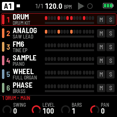
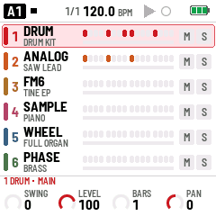

## What's new in 0.3

- **A SETTINGS screen.** Everything that belongs to the FM-1 itself now has its own full screen (hold HOME, or SHIFT +
  GLO). GLO's pages are only the song's (section 14).
- **Keys.** The drum keys play the General MIDI kit with C4 as the kick, GLO's layer has MIDI LEARN on D4 and
  FILL on E4, WHITE mode puts the root on C4, EDIT + black keys mute drums, and there is a STD kit (section 9).
- **Overdub or replace** while recording (SHIFT + REC), and **EDIT + REC** to empty a channel at once (section 10).
- **Bars in the step editor:** hold SEQ and turn SELECT (section 6).
- **Store into a scene:** hold SAVE and hold a scene's key for a second (section 13).
- **Graphs** of the pages, on request (section 8).
- **Buttons** act exactly once: a tap when you let go, a hold when its time comes. HOME is lit on the main screen.
- **Lighter sound engine:** FM6 costs far less, standing by costs almost nothing, and a chord too big for the CPU
  thins out with `VOICE LIMIT` instead of breaking up.

## Contents

1. Installing, and going back to stock
2. The panel
3. Channels, tap and hold, and SHIFT
4. A first beat and a first song in five minutes
5. The buttons, one by one
6. The layers
7. Every page, knob by knob
8. The graph views
9. The instruments and kits
10. Recording and the step sequencer
11. Scales and chords
12. Mixing and effects
13. Patterns, scenes and songs
14. Settings
15. MIDI, Bluetooth and clock
16. Saving, autosave and backup
17. Troubleshooting
18. Cheat sheet

---

## 1. Installing, and going back to stock

nullwave is early software, so back up first. Make a full flash backup of the FM-1 with
[M-Flasher](https://github.com/jvitkauskas/m-flasher) before the first install, and keep the file. It puts the FM-1
back exactly as it was, whatever happens.

**The easy way.** Open the nullwave installer page in Chrome or Edge, connect the FM-1 with a USB cable and switch it
on. The page finds it, shows what it will write and asks before writing. When it is done the FM-1 restarts into
nullwave. Later versions install the same way, over the top; your songs and settings stay.

**From a terminal.** With Python installed:

```
python3 -m pip install --user mido python-rtmidi
python3 base/tools/fm1_install.py nullwave.fwsc
```

**Going back.**

- To M-VAVE's own firmware: the "Back to the stock firmware" button on the installer page, or M-VAVE's updater
  (M-UPGRADE) with their firmware file.
- To exactly what you had before: restore the M-Flasher backup.
- If nullwave starts but the computer cannot see it over USB: hold REC while switching on. The FM-1 starts in its
  update mode and the installer can write it again. After two failed starts in a row, nullwave also opens a safe mode
  of its own where USB still works.
- If nothing starts at all: restore the backup with M-Flasher. If you installed the recovery bootloader the installer
  offers, hold PLAY while switching on to reach its menu instead.

[docs/INSTALL.md](INSTALL.md) has the same steps with more detail.

## 2. The panel

The FM-1 has 27 keys (F3 to G5: 16 white, 11 black), fourteen buttons, seven knobs and a small colour screen.

- **The keys** play notes. They feel how hard you hit (velocity) and how hard you keep pressing (pressure).
- **The function buttons** across the top: FX, SEL, ENV, LFO, EDIT, GLO, HOME, SAVE, ARP, SEQ. Each one has pages of
  settings (tap it) and most have a layer (hold it).
- **The transport:** PLAY and REC.
- **OCT− and OCT+** move the keyboard an octave. Held, they are SHIFT.
- **SELECT** (the big knob) sets the tempo on the main screen and turns pages elsewhere.
- **ALGORITHM** picks the channel you play. **PRESETS** picks that channel's sound.
- **KNOB 1–4** set the four values shown at the bottom of the screen.

The screen has three parts:

- **The top bar:** the song and scene (`A1` is song A, scene 1), the bars of the pattern with the one playing lit,
  the tempo, play and record, and the battery.
- **The middle:** the six channels. Each row shows the instrument and sound, a strip of 16 cells for the bar playing
  (lit where there are notes, white where the playhead is), a level meter, and **M** (mute) and **S** (solo). The
  channel you are playing has a tinted box around it.
- **The footer:** which channel and page you are on, and four knobs with their values. Short messages flash here when
  you do something.

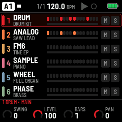

## 3. Channels, tap and hold, and SHIFT

**Channels.** nullwave has six channels, and they are all equal: any of them can be any instrument, a synth or a drum
kit. Turn ALGORITHM to pick the channel the keys play. Everything you change on a page changes that channel. A new
song starts with a drum kit on channel 1 and five different synths on 2–6.

**Tap and hold.** Every function button does two things:

- A **tap** (under half a second) opens its pages: four settings at a time in the footer. Tap the button again, or
  turn SELECT, to see its next page. HOME takes you back to the main screen, and its light shows you're there. A tap
  acts once, when you let go.
- A **hold** turns the keys into that button's **layer**: the 16 white keys become 16 tiles on the screen, each with
  a job (mute a channel, launch a scene, set a step, fire an effect). KNOB 1–4 change too. Let go and the keys play
  notes again. The layer appears after about a third of a second (or at once if you touch a key or knob), so a quick
  tap never flashes it. To keep a layer open with your hands free, hold the button and tap HOME; the same button
  again, or any other, lets it go.

**SHIFT.** Holding OCT− or OCT+ is SHIFT. A short press of either still moves the octave, when you let go, as long as
you did nothing else meanwhile. SHIFT + another button does something extra:

- SHIFT + GLO opens the SETTINGS screen (the same as holding HOME).
- SHIFT + the button of the page you are on shows that page as a graph (section 8).

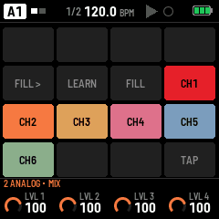
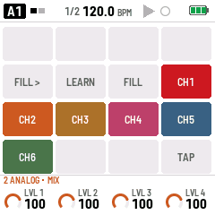

## 4. A first beat and a first song in five minutes

**A beat.**

1. Switch on. Channel 1 is a drum kit; ALGORITHM shows `1 DRUM` in the footer.
2. Hold **SEQ**. The white keys are now the 16 sixteenth notes of a bar.
3. Still holding SEQ, press the black key for the kick (the first one), then the white keys 1, 5, 9 and 13. Each one
   lights: a kick on every beat.
4. Press the second black key (snare), then white keys 5 and 13.
5. Let go of SEQ and press **PLAY**. Turn SELECT to change the tempo.

**A bass line on top.**

1. Turn ALGORITHM to channel 2 (ANALOG). Turn PRESETS to pick a sound you like.
2. While the beat plays, tap **REC**. The record circle turns red.
3. Play a few notes. When the loop comes round, you hear them back, and anything you add is layered on top.
4. Tap REC again to stop recording. The loop keeps playing.

If you get it wrong, hold **EDIT** and press OCT− to undo the last pass.

**A second scene.** A scene is a snapshot of which pattern each channel plays. You are in scene 1.

1. Hold **SAVE** and press F# (the first black key), then white key 2. Scene 1 is copied into scene 2.
2. Hold SAVE and press white key 2. At the next bar, scene 2 starts. Change something: record a new part on channel 3,
   or mute the drums (hold GLO, press F4, the first key of the second octave: it mutes channel 1).
3. Hold SAVE and press white key 1 to go back. You now have two scenes to switch between, live.

**A song.** Hold SAVE and press G# to switch from loop mode to song mode. Turn to the CHAIN page (tap SAVE, then turn
SELECT twice): each step of the chain is a scene, how many bars it plays and how often it repeats. PLAY now plays
the chain from the top. To make a chain by playing instead, hold SAVE and press A# (song recording), press PLAY, and
launch scenes as you like; every launch becomes a step.

**Keep it.** Tap SAVE: the SONG page opens. Tap SAVE again (twice, to be sure) to save the song in its slot. With
AUTOSAVE on (the default) nullwave also saves by itself a few seconds after you stop.

## 5. The buttons, one by one

**FX.** Tap: the channel's effects (drive and sends, filter, slicer, insert, then the shared delay and reverb). Hold:
the punch-in layer, 27 performance effects on the keys. With FX held, OCT− throws the whole mix into the reverb and
OCT+ into the echo for as long as you hold them, and SELECT sets how fast the punch-ins fade in and out.

**SEL.** Tap: the key and scale pages. Hold: the key layer; press a key to make it the song's root note.

**ENV.** Tap: the channel's envelope (how a note starts, holds and ends) and where else that envelope goes.

**LFO.** Tap: the channel's LFO, a slow wave that moves the pitch, filter, shape or volume.

**EDIT.** Tap: the instrument's own settings (its eight knobs, plus extra pages on some instruments), then how the
channel's voices behave. Hold: the erase layer; press a key to erase that note from the loop. EDIT + OCT− is undo,
EDIT + OCT+ redo.

**GLO.** Tap: the song's settings (tempo, swing, click, tune, the master effects, the texture bed, the drum channel's
levels). Hold: the mix layer: mutes, solos, fills, MIDI LEARN, tap tempo, and the first four channels' levels on the
knobs. SHIFT + GLO: the SETTINGS screen.

**HOME.** Tap: back to the main screen. Tapped on the main screen: the visualiser, round its styles and off again.
Hold: the SETTINGS screen, everything that belongs to the FM-1 itself (section 14).

**SAVE.** Tap: the SONG page; tap again there to save. Turn SELECT for the other pages: sounds, your own presets,
scenes, the song chain and tools. Hold: the scene layer.

**ARP.** Tap: the arpeggiator. Hold: the roll layer; held keys repeat in time.

**SEQ.** Tap: the pattern page, then the notes of the pattern. Hold: the step layer.

**PLAY.** Start and stop.

**REC.** Playing: record on the selected channel; tap again to stop recording. Stopped: get ready to record (the REC
page). Hold for two seconds: clear the channel's pattern (undo brings it back).

**OCT− / OCT+.** Move the keyboard down or up an octave. Both together: back to the middle. Held: SHIFT.

## 6. The layers

Hold a button and its layer appears as 16 tiles, one for each white key.

**GLO, the mix.** D4 starts MIDI LEARN and E4 plays a fill while you hold it.
Around them: C4 makes the next bar a fill, the six white keys F4 to D5 mute channels 1–6, the black keys above them
(F#4 to F#5) solo channels 1–6, and G5 is tap tempo. A channel's tile is lit in its colour, dark when muted and white
when soloed. KNOB 1–4 are the levels
of channels 1–4.

**SEL, the key.** Any key sets the song's root. KNOB 1 chord, 2 scale, 3 keys mode, 4 transpose.

**EDIT, erase.** Press a key: while playing, that note is erased wherever the playhead passes while you hold it;
stopped, it is erased from the whole pattern. On a drum kit, black keys 1–8 mute its eight drums instead (press again to bring one back; a muted drum keeps playing unheard, so it comes back in time). KNOB 1 shifts the pattern a step earlier or later, KNOB 2 doubles or
halves its length, KNOB 3 transposes it.

**SEQ, the steps.** The 16 keys are the 16 steps of a bar. In a longer pattern, turn SELECT (or press OCT− and OCT+)
while holding SEQ to pick the bar: the footer says `STEPS BAR 2/4`, the top bar lights that bar, and the DRUMS page
follows it. Stopped, SEQ comes back to the bar you picked. Press a
step to set it; press it again to clear it. Hold a step and KNOB 1–4 set its note, velocity, ratchet (repeats within
the step) and nudge (a little early or late). While holding a step, ALGORITHM picks any sound parameter and PRESETS
sets its value for that step only: a parameter lock. OCT− clears the step's extras; OCT+ gives it a fill condition
(plays always, only in fills, or never in fills). On a drum kit, the black keys choose which drum the steps place.

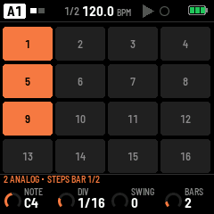
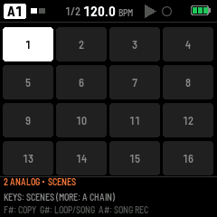
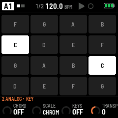
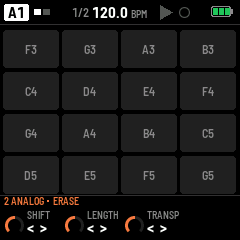
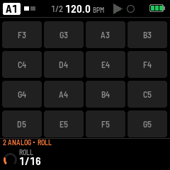

**SAVE, the scenes.** Keys 1–16 launch scenes 1–16 when you let go of the key. Hold a key for a second instead and
what plays now is stored into that scene (`SCENE 3 STORED`). Several keys in one hold make a quick chain that loops
through them. F# then a key copies the current scene there. G# switches loop and song mode. A# turns song recording on and off.

**FX, punch-ins.** Each key holds an effect while pressed; several stack. White keys: LOOP 1/4, LOOP 1/8, LOOP 1/16,
LOOP 1/32, STUTTER, REVERSE, TAPE STOP, HALF, LP SWEEP, HP SWEEP, PHONE, CRUSH, ALIAS, GATE, ECHO, WOBBLE. Black keys:
KILL LOW, KILL MID, KILL HIGH, REWIND, OCT UP, FLANGER, AUTO-PAN, FREEZE, LOOP 8T, MONO, FADE OUT. KNOB 1 is a DJ
filter on the whole mix, 2 DUST, 3 DUCK, 4 the channel's own one-knob filter.

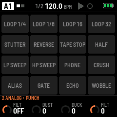
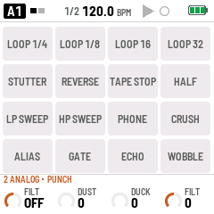

**ARP, rolls.** Held keys repeat at the ROLL rate (KNOB 1), and are recorded when you record. Hold OCT− as well for
soft ghost notes, OCT+ for hard ones.

## 7. Every page, knob by knob

Pages show four settings, one per knob. The footer says the page's name and number (`FX 2/7`); the dots on the right
show where you are. Tap the button again or turn SELECT for the next page.

**ENV**

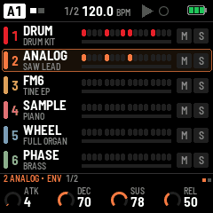
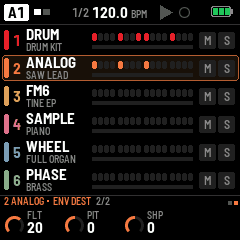

- ENV: ATK (attack, how fast a note rises), DEC (decay, how fast it falls to the sustain level), SUS (sustain, the
  level while you hold the key), REL (release, how long it rings after you let go).
- ENV DEST: FLT, PIT and SHP send the same envelope to the instrument's filter, its pitch and its shape. Turn right
  for more, left to move the other way.

**LFO**

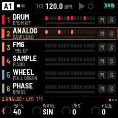
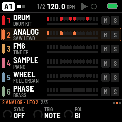
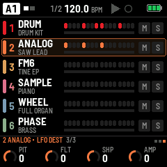

- LFO: RATE, WAVE (sine, triangle, saw, square, random steps), PHS (where in its cycle it starts), FADE (how long it
  takes to come in after a note).
- LFO 2: SYNC (free, or locked to the tempo from 4 bars to 1/32), TRIG (NOTE restarts it with each phrase, FREE lets
  it run), POL (BI swings both ways, UNI only up).
- LFO DEST: how much it moves the pitch (vibrato), the filter (wobble), the shape, and the volume (tremolo).

**FX**

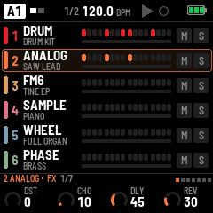
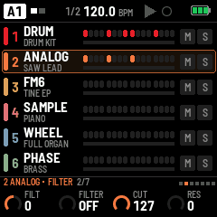
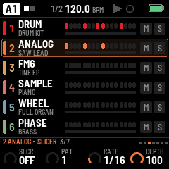
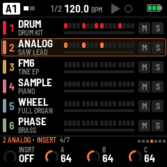
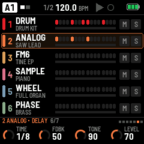
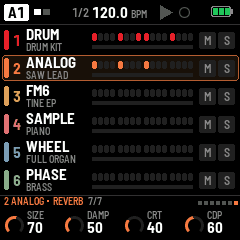

- FX: DST (drive), CHO (chorus send), DLY (delay send), REV (reverb send).
- FILTER: FILT is a one-knob filter: left of the middle closes a low-pass, right opens a high-pass. FILTER, CUT and
  RES are a full filter: its type, cutoff and resonance.
- SLICER: chops the channel in time. SLCR (off, GATE, STUT), PAT (16 rhythms), RATE (1/8 to 32T), DEPTH.
- INSERT and INSERT 2: one effect in the channel's path. Drives (SOFT, HARD, FOLD, FUZZ: A drive, B tone, C level),
  CRUSH (A bits, B rate, C tone) and moving effects (PHASR, FLANG, CHOR: A rate, B depth, C feedback). MIX on the next
  page.
- DELAY: TIME (1/32 to 1/2, dotted values in between, always in time), FDBK, TONE, LEVEL. Shared by all channels.
- REVERB: SIZE, DAMP, and the shared chorus's rate (CRT) and depth (CDP).

**SEL**

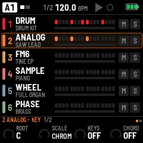
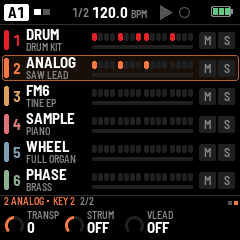

- KEY: ROOT, SCALE, KEYS (OFF, SNAP, WHITE), CHORD.
- KEY 2: TRANSP (the whole song up or down), STRUM, VLEAD.

**EDIT**

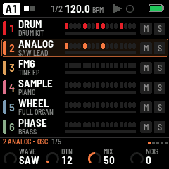
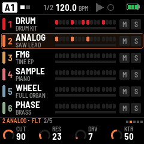
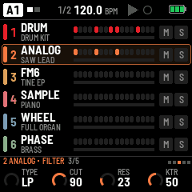
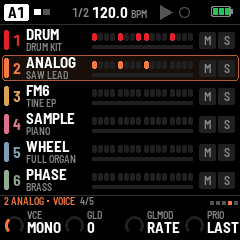
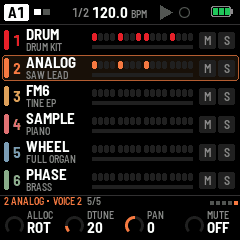
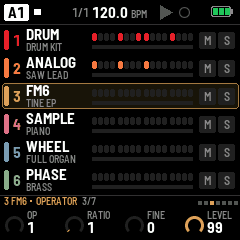
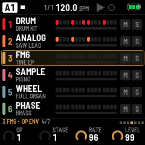
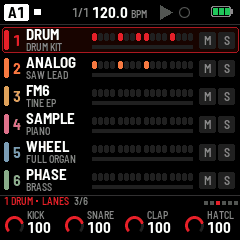

- EDIT 1 and EDIT 2: the instrument's eight settings (section 9).
- Extra pages on some instruments: FILTER on ANALOG; OPERATOR, OP ENV and OPERATOR 2 on FM6; LANES and LANES 2 on
  DRUM.
- VOICE: VCE (POLY, MONO, LEG for legato, UNI for a thick unison), GLD (glide), GLMOD (glide by rate or by time),
  PRIO (in mono, which note wins: the last, the lowest or the highest).
- VOICE 2: ALLOC (rotate through voices or reuse the same one for a repeated note), DTUNE (unison spread), PAN, MUTE.

**ARP**

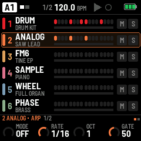
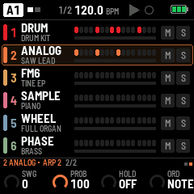

- ARP: MODE (OFF, UP, DN, UPDN, RND, ORD, REPEAT, DNUP, UP+8, CONV, DIVG, PINKY, THUMB, WALK, CHORD), RATE, OCT (1–4
  octaves), GATE (note length).
- ARP 2: SWG (swing), PROB (the chance each step plays), HOLD (the notes keep going after you let go; with MODE OFF it
  simply holds the chord), ORD (sort the notes, or keep the order you played them).

**SEQ**

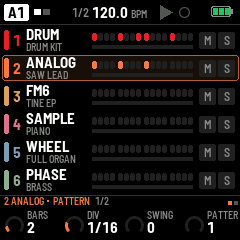

- PATTERN: BARS (1–8), DIV (the step size: 1/32, 1/16T, 1/16, 1/8T, 1/8, 1/4, 1/2, 1 BAR, 2 BAR), SWING, PATTERN
  (which of the channel's 16 patterns this scene plays).
- NOTES (a synth channel): the pattern as a piano roll. NOTE# picks a note, PITCH moves it up and down, MOVE moves it
  a step earlier or later, LENGTH makes it longer or shorter.
- DRUMS (a kit channel): the eight drums down the side, the steps across. LANE and STEP move the cursor, HIT turns
  the hit on (right) or off (left), VEL sets its velocity.

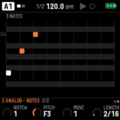
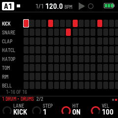
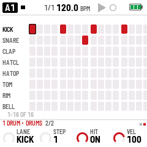

**GLO**

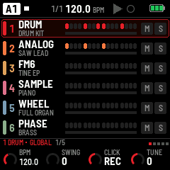
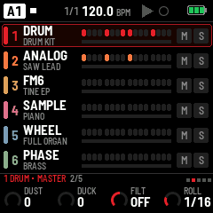
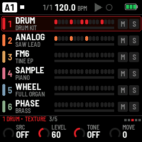
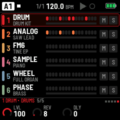

- GLOBAL: BPM, SWING for the whole song, CLICK (off, while recording, always), TUNE (±50 cents).
- MASTER: DUST (crackle), DUCK (the kick pushes the rest down), FILT (a DJ filter on everything), ROLL (the roll
  layer's rate).
- DRUMS: the level, reverb and delay of the kit channel.

These are all saved with the song. Everything that belongs to the FM-1 itself is on the SETTINGS screen (section 14).

**SAVE**

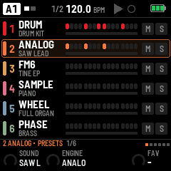
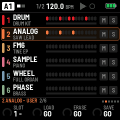
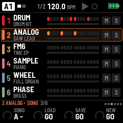
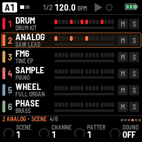
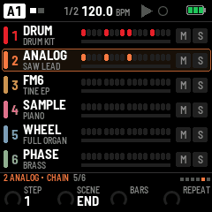
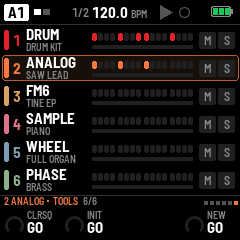

- PRESETS: SOUND browses every sound, ENGINE jumps between instruments, FAV marks a sound as a favourite.
- USER: SLOT (1–32), LOAD, ERASE, SAVE your own sounds.
- SONG: SONG (A–H), LOAD, SAVE, NEW.
- SCENE: SCENE, and for each CHANNEL which PATTERN it plays there; SOUND: whether the scene brings its own sounds.
- CHAIN: STEP, SCENE, BARS, REPEAT (section 13).
- TOOLS: CLRSQ (clear the channel's notes), INIT (reset its sound), NEW (a new song).

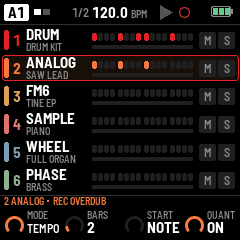

**REC** (when armed): MODE (FREE or TEMPO), BARS (1, 2, 4, 8), START (on the first NOTE or after a COUNT-in), QUANT.

## 8. The graph views

Some pages are easier to understand as a picture. Hold SHIFT (OCT− or OCT+) and press the button of the page you are
on: the area above the footer becomes a graph of that page. The knobs stay in the footer, and the graph redraws as you
turn them, and as the sound plays. Do it again to go back to the channels. nullwave remembers your choice for each
kind of page. SETTINGS → SCREEN → GRAPHS sets whether pages start with their graph or not.


- **ENV:** the envelope's shape, attack, decay, sustain and release, with a dot riding on it while a note plays.
- **ENV DEST:** the envelope as it reaches each destination, scaled and turned by FLT, PIT and SHP.
- **LFO:** one cycle of the wave from its phase, the fade-in as a ramp, the rate or sync value, and a dot moving
  with the LFO.
- **FILTER and the engine filter:** how loud each frequency comes through, from 20 Hz to 20 kHz: the cutoff, the
  resonance peak, and the one-knob filter.
- **EDIT 1 and EDIT 2:** a live scope of the channel's sound.
- **DELAY:** the echoes in beats, each one quieter by the feedback.
- **SLICER:** the pattern on 16 steps, the step playing lit.
- **ARP:** the order the arpeggiator will play your notes in, over its octaves (with no keys held, a C major chord).
- **SEL:** the scale on a two-octave keyboard, the root in white.
- **INSERT:** how the drive bends the sound: what goes in across, what comes out up.


The visualiser is the main screen's picture: tap HOME on the main screen for BARS, again for RINGS, again for SCOPE,
and again to see the channels.


## 9. The instruments and kits

Turn PRESETS to hear the sounds: your favourites come first, then every instrument's sounds in turn, then your own
presets. EDIT shows the instrument's eight knobs on two pages.

- **ANALOG:** a classic two-oscillator synth with a filter. Basses, leads, pads. Its extra FILTER page has the filter
  type, cutoff, resonance and key tracking.
- **FM6:** a six-operator FM synth in the style of the 1980s classics: electric pianos, bells, basses, brass. ALG
  picks one of 32 ways to wire the operators; SLOT picks a factory patch (F1–F8), the channel's own (OWN) or one of 32
  from a bank (B1–B32). The OPERATOR pages edit each operator. Send a DX7 voice or a 32-voice bank by SysEx and it
  lands in OWN or the bank.
- **PHASE:** phase distortion, bright and glassy, with a sub oscillator and wavefolding.
- **LOFI:** chip-tune sounds: pulse waves, crushed bits, sweeps, arpeggios.
- **SAMPLE:** recorded instruments (piano, flute, sax) played across the keys.
- **VOICE:** a singing voice: pick two vowels and glide between them; breath, buzz and character.
- **TRIO:** three oscillators and a multimode filter, for fat basses and sync leads.
- **WHEEL:** a tonewheel organ with percussion, key click, drive and a rotary speaker.
- **GRAIN:** clouds of tiny pieces of the sample sets: pads, glitches, frozen textures.
- **PHYS:** struck and plucked things modelled physically: bells, marimbas, strings, drums.
- **NOISE:** wind, rain, metal and arcade noise that follows the keys.
- **SLICE:** a loop cut into slices, one on each key.
- **DRUM:** a synthesised drum kit with eight drums. Its EDIT pages shape the whole kit (KIT picks STD, the standard
  kit, or 80, 10, 66, 55, 77, DEEP, TIGHT or PERC; then tune, decay, tone, drive, crush, accent, level); LANES and LANES 2 set each drum's level.

**The keys.** On a synth, the keys play notes from F3, moved by the octave. On DRUM, the keys
play the General MIDI drum notes, and the octave buttons leave them alone:

| Key | Drum |
|---|---|
| C4 | KICK |
| C#4 | RIM |
| D4, E4 | SNARE |
| D#4 | CLAP |
| F#4, G#4 | closed hat (G#4 the pedal hat) |
| A#4 | open hat |
| F4, G4, A4, B4, C5, D5 | TOM, from low to high |
| C#5, D#5 and up | BELL (the cymbals) |

F3 to B3 play the same as F4 to B4. The closed hat cuts off an open one. Over MIDI the drums sit on the same notes
(kick 36, snare 38 and so on). On SLICE, each key plays one slice, in order from F3.

## 10. Recording and the step sequencer

**Recording while playing (overdub).** Press PLAY, tap REC, play. Each time round, what you play is added. With QUANT
on (REC page) notes snap to the nearest step; with it off they keep your timing. Tap REC again to stop recording.

**Starting from silence.** Tap REC while stopped: the REC page opens and the record circle is a ring (armed).

- With START on NOTE, the first note you play starts the loop.
- With START on COUNT, press PLAY and you get a bar of clicks first.
- MODE FREE in a new song: just play. When you reach the loop's "one" again, tap REC: nullwave picks the length (1, 2,
  4 or 8 bars) and the tempo from your playing.
- MODE TEMPO keeps the tempo set and records BARS bars.

**The click.** GLO → GLOBAL → CLICK: off, only while recording, or always.

**Overdub or replace.** REC MODE decides what a pass does. OVERDUB (the default) adds what you play to what is
there. REPLACE wipes what was there as the playhead passes, so a new pass overrides the take: keep playing and only
the new playing stays. Hold SHIFT (OCT− or OCT+) and press REC to flip between them, even in the middle of a take;
with REPLACE on, the record dot in the top bar shows an R. The same setting is in SETTINGS → SEQ.

**Starting again.** Hold EDIT and press REC to empty the channel at once, or hold REC for two seconds. EDIT + OCT−
brings it back if you change your mind.


**Undo.** EDIT + OCT− undoes the last pass (or erase, or clear); EDIT + OCT+ redoes it. Hold REC for two seconds to
clear the channel.

**Steps.** Hold SEQ and set steps with the keys (section 6). A step can hold a chord, a velocity, a ratchet, a nudge
and parameter locks. Patterns can be 1 to 8 bars; DIV sets the step size, from 1/32 notes to two bars a step.

**Fills.** Mark steps FILL ONLY (a crash, a roll) or NO FILL (the kick that drops out) with SEQ held, the step held,
and OCT+. Hold GLO and E4 to play the fill while you hold it, or C4 to make the next bar a fill.

**Rolls and the arpeggiator.** Both run in time and are recorded as notes, so a roll or an arpeggio becomes part of
the loop.

## 11. Scales and chords

**Key and scale.** SEL + a key sets the root. SEL → KEY → SCALE picks one of 16 scales (major, minor, the modes,
pentatonics, blues, whole tone, hirajoshi, diminished, chromatic). With a scale on, the keys light up to show it.

**KEYS mode.** OFF: every key plays its own note. SNAP: a key outside the scale plays the scale note just below, so
you can't hit a wrong note. WHITE: C4 plays the root and the white keys walk the scale up and down from it; the black keys are silent.

**Chords.** Set CHORD (TRIAD, 7TH, 9TH, SUS4, POWER) and each white key plays the chord on that step of the scale,
starting from C4. Hold black keys to change the chord as you play (CHORD+):

- F#: major turns minor, minor turns major.
- G#: add the seventh.
- A#: sus4.
- C#: add the ninth.
- D#: an inversion.

STRUM (KEY 2) plays the chord's notes one after the other, up or down, like a guitar. VLEAD moves each chord's notes
by octaves so they stay close to the last chord, the way a pianist would play it.

TRANSP moves the whole song up or down, up to two octaves, without changing the drums.

## 12. Mixing and effects

**Levels, mutes and solos.** Hold GLO: F4 to D5 mute channels 1–6, the black keys F#4 to F#5 solo them, KNOB 1–4 set channels 1–4's levels. The main page's
KNOB 2 sets the selected channel's level, KNOB 4 its pan.

**Per channel.** Each channel has drive, an insert effect, a slicer, a one-knob filter and a full filter, an envelope
and an LFO, and sends to the chorus, delay and reverb.

**Shared.** One delay (in time with the tempo), one reverb, one chorus. Their settings are on FX → DELAY and REVERB.

**The master.** GLO → MASTER: DUST adds vinyl crackle, DUCK makes the kick push everything else down (a pumping
sidechain), FILT is a DJ filter over the whole mix. TEXTURE adds a bed of sound under everything. A limiter at the end
keeps it all from clipping.

**Punch-ins.** Hold FX and play the keys for the 27 performance effects (section 6). They are for the moment: they
are not recorded into the song. FX + OCT− and OCT+ throw the whole mix into the reverb or the echo while held.

## 13. Patterns, scenes and songs

**Patterns.** Every channel has 16 patterns. A pattern is 1–8 bars of notes, with its own step size and swing.
Channels can have different lengths, so a 3-bar line can run against a 4-bar beat.

**Scenes.** A song has 16 scenes, one per white key. A scene says which pattern each channel plays, which channels are
muted or soloed, and their levels. With SOUND on (SAVE → SCENE) it carries the six sounds too. A new scene *n* plays
pattern *n* on every channel, so launching an unused scene gives you empty patterns to fill.

**Switching scenes live.** Hold SAVE and press a scene's key.

- Stopped, it changes at once.
- Playing, it waits for the moment set by SETTINGS → SEQ → SCENE LAUNCH: the next bar (BAR), when the current scene's
  longest pattern comes round (LOOP), or straight away (NOW).
- The queued scene blinks in the top bar until it starts.

**Recording while switching.** Recording always goes into the patterns of the scene that is playing. So you can
record a part in scene 1, launch scene 2, keep recording, and the new notes land in scene 2's patterns. Record a
verse, launch the chorus scene, play the chorus part, launch back: each scene keeps its own take.

**Quick chain.** Hold SAVE and press several scene keys in one hold: they play one after another, round and round,
until you launch a single scene again.

**Store.** Hold SAVE and hold a scene's key for a second: what plays now (the patterns, mutes, solos, levels) is
stored into that scene, and the screen says `SCENE 3 STORED`. A short press of the key launches the scene instead.
The scenes are part of the song, so they reach the FM-1's memory when the song is saved: SAVE twice, or AUTOSAVE a
few seconds after you stop.

**Copy.** Hold SAVE, press F#, then a scene key: the current scene, with all its patterns, is copied there. Useful to
make a variation.

**Songs.** SAVE + G# turns song mode on: PLAY then plays the chain. The CHAIN page lists its steps: STEP picks one,
SCENE sets its scene, BARS how long it plays (CUE: until you launch the next one), REPEAT how many times. Turning SCENE
past the last step adds one. Or record the chain by playing: SAVE + A#, PLAY, and launch scenes; each launch becomes a
step with the bars it played. STOP ends the song recording.

## 14. Settings

The pages you reach by tapping a button only hold what belongs to your music: a channel's sound, or the song (GLO).
Everything that belongs to the FM-1 itself has its own screen, SETTINGS. Hold HOME to open it, or press SHIFT + GLO.

It fills the screen below the top bar. The title bar names the group and shows its pages as dots; below are up to four
rows, each with its knob number, its name and its value. KNOB 1–4 change the four rows, as on every other page. Turn
SELECT for the next page, tap HOME for the next group, and hold HOME again to go back to your music. Every setting is
in exactly one place, and saves itself a moment after you change it.

The groups are SCREEN, LIGHTS, AUDIO, SEQ, SYSTEM, MIDI, KEYS and BLUETOOTH.

- **SCREEN:** THEME (dark or light), KNOB ACCEL (fast turns move further), GRAPHS (whether pages open with their
  graph).
- **LIGHTS:** BUTTON LIGHTS, SCALE ON KEYS (the scale shown on the keys).
- **AUDIO:** SPEAKER LOWCUT (takes out the lows the small speaker can't play, cleaner and louder), USB AUDIO (the sound
  sent to a computer at the MASTER volume, or always full), FILTER RESO (the resonance of the one-knob filters).
- **SEQ:** STEP ADVANCE (on the DRUMS page, the cursor moves on after each hit), DRUM PREVIEW (hear a drum when you
  pick it), SCENE LAUNCH (when a launched scene starts: the next bar, the end of the loop, or at once), REC MODE
  (OVERDUB or REPLACE, section 10).
- **SYSTEM:** VERSION, AUTOSAVE, CPU (how busy the sound engine is).
- **MIDI**, four pages: each channel's MIDI channel; MIDI IN and OTHER CH; MIDI OUT, BEND RANGE, DRUM MAP and FX
  CHANNEL; REMOTE, CLOCK OUT and SYNC (section 15).
- **KEYS:** VELOCITY (how much your touch changes the volume), KEY LEARN (each key learns its own range as you play),
  FIXED VEL (every note at one velocity), PRESSURE (what pressing harder does: filter, volume, both or nothing).
- **BLUETOOTH:** on or off, a DEVICE to connect to, CONNECT.


## 15. MIDI, Bluetooth and clock

**Channels.** Channels 1–6 send and receive on MIDI channels 1–6. Change them on SETTINGS → MIDI; two channels never share
one.

**What comes in.** Notes, pitch bend (range on MIDI 2), aftertouch, the sustain pedal, and program changes (pick the
channel's sound). Common controllers set parameters: CC 1 vibrato depth, 5 glide, 7 and 11 level, 10 pan, 71
resonance, 72 release, 73 attack, 74 cutoff, 75 decay, 91 reverb, 93 chorus, 94 delay; 121 resets.

**MIDI LEARN.** Hold GLO and press D4 (the footer says `LEARN: TURN A KNOB`). Let go, open any page and turn the knob
you want to control: the footer asks for a CC. Move the controller: done. Eight learned controls are kept.

**IN and OTHER.** IN on MIDI 2: NOTES (everything), CLOCK (only the clock) or one MIDI channel played on the selected
channel. OTHER: notes on a MIDI channel no channel uses go to the selected channel, or are ignored.

**OUT.** KEYS sends what you play; SEQ sends what the sequencer plays too.

**MIDI 3.** FX CH: notes 36–62 on that channel hold the 27 punch-ins, so a pad controller can fire them. DR MAP: a
kit's notes as General MIDI, or 16 notes in a row from 36. REMOTE: CC 102–115 press the FM-1's buttons. CLOCK: send
MIDI clock over USB.

**Clock.** SETTINGS → MIDI → SYNC: INT (nullwave keeps time), USB, TRS (the MIDI jack) or BLE. Following a clock, START,
CONTINUE and STOP drive the transport; if the clock stops for half a second, nullwave carries on at its last tempo. As
the master with CLOCK on, nullwave sends clock all the time, also while stopped.

**Bluetooth.** SETTINGS → BLUETOOTH. The FM-1 shows up as a Bluetooth MIDI device to a computer, phone or tablet, and can
connect to a Bluetooth MIDI keyboard or controller itself: turn DEVICE to pick one found nearby, then CONNECT twice.

## 16. Saving, autosave and backup

**Songs.** Eight songs, A–H, each in its own slot. SAVE → SONG: turn SONG to pick a slot, LOAD (twice) to open it,
SAVE (twice) to save, NEW (twice) for an empty song. Or simply tap SAVE twice from anywhere. Saving works while
stopped. The FM-1 starts with the song you used last.

**Autosave.** With AUTOSV on (the default), the song saves itself three seconds after you stop and leave it alone.

**Your sounds.** SAVE → USER saves the selected channel's sound in one of 32 slots, with LOAD and ERASE. FAV on the
PRESETS page puts a sound at the front of the PRESETS list.

**Backup.** A song that is too big for its slot says `SONG FULL`. A save cut short by a power cut leaves that slot
empty, so keep a backup of what you care about: fm1-base's backup page saves everything on the FM-1 to a file on your
computer and puts it back.

## 17. Troubleshooting

- **No sound.** Check the volume knob, mutes and solos (hold GLO), the channel's level (MAIN, KNOB 2), and that the
  sound is not a quiet one. Headphones in mute the speaker.
- **The keys play the wrong notes.** Check the octave (OCT− and OCT+ together resets it), KEYS mode and CHORD on SEL,
  and TRANSP.
- **A recording sounds late or early.** Turn QUANT on (REC page) to snap to the steps, or nudge the steps.
- **A scene does not change.** Look at SCENE LAUNCH (SETTINGS → SEQ): with LOOP it waits for the longest pattern.
- **The tempo will not change.** SYNC is following an outside clock (SETTINGS → MIDI).
- **`VOICE LIMIT`.** The sound engine came close to running out of time, so the oldest note was faded out rather than
  letting the audio break up. Fewer notes held at once, a lighter instrument than FM6, or UNI off. SETTINGS → SYSTEM
  → CPU shows the load: a few % standing by.
- **`CPU OVERLOAD`.** A block of sound did run late (a click may be heard): as for VOICE LIMIT.
- **A note doesn't sound in a big chord.** Each channel plays up to 6 notes (FM6 and VOICE 4; SAMPLE, GRAIN and PHYS
  3); a further note takes the oldest one's place.
- **A setting seems stuck.** Settings are saved by themselves when the FM-1 is quiet; give it two seconds after a
  change before switching off.
- **Something is badly wrong.** Hold REC while switching on and reinstall, or go back to stock (section 1).

## 18. Cheat sheet

| Do this | How |
|---|---|
| Pick a channel / its sound | ALGORITHM / PRESETS |
| Tempo | SELECT on the main screen; tap it: GLO + G5 |
| Play / stop | PLAY |
| Record, stop recording | REC, REC (stopped: REC arms, the first note starts) |
| Overdub ↔ replace | SHIFT + REC |
| Clear the channel | EDIT + REC (at once), or hold REC 2 s |
| Undo / redo | EDIT + OCT− / EDIT + OCT+ |
| Steps | hold SEQ, press keys |
| The bar the steps show | SEQ + SELECT (or SEQ + OCT−/OCT+) |
| Lock a parameter on a step | SEQ + hold the step: ALGORITHM picks, PRESETS sets |
| Fill condition of a step | SEQ + hold the step + OCT+ |
| Fill now / the next bar | GLO + E4 / GLO + C4 |
| Mute / solo | GLO + F4–D5 / GLO + black keys F#4–F#5 |
| Launch a scene | SAVE + its key (on release) |
| Store into a scene | SAVE + hold its key 1 s |
| Quick chain | SAVE + several keys |
| Copy the scene | SAVE + F#, then a key |
| Loop ↔ song mode / song recording | SAVE + G# / SAVE + A# |
| Punch-ins | hold FX, press keys |
| Reverb / echo throw | FX + OCT− / FX + OCT+ |
| Rolls | hold ARP, press keys (OCT− ghost, OCT+ hard) |
| Root note | SEL + key |
| Chord changes | CHORD on, hold black keys |
| Mute a drum | EDIT + black keys 1–8 on a kit |
| Graph of a page | SHIFT + that page's button |
| Visualiser | HOME on the main screen |
| SETTINGS | hold HOME, or SHIFT + GLO |
| Next settings group / leave | tap HOME / hold HOME |
| Keep a layer open / close it | hold its button + tap HOME / its button again |
| Octave 0 | OCT− + OCT+ |
| MIDI LEARN | GLO + D4, turn a knob, send a CC |
| Save the song | SAVE, SAVE |

## The reference

Everything above in tables, page by page, is in the [manual](../app/docs/MANUAL.md).
